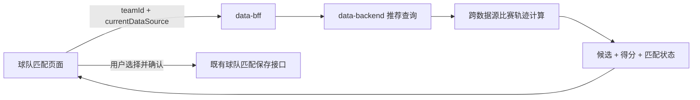
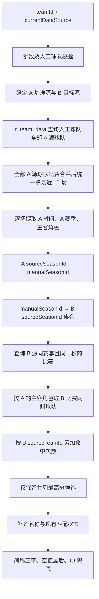

# 球队智能推荐查询接口最终版分析

> 文档性质：接口需求、测试判定口径与数据闭包的最终整合分析  
> 适用范围：足球（`sport_id = 1`）球队智能推荐查询  
> 最终口径：采用功能测试 SQL 的“先映射 A 赛季到人工赛季，再反查 B 赛季”思路，不采用开发代码的赛事 ID + 赛季 ID 复合映射思路  
> 数据影响：本接口及本文所述验证逻辑均为只读，不创建、修改或删除球队匹配关系

---

## 1. 分析依据与最终确认

### 1.1 分析依据

本文整合以下材料及已经完成的讨论结论：

1. `匹配球队.md` 中的原始业务需求；
2. `球队智能推荐查询.openapi.json` 中的接口结构；
3. 已归档的 `team-match-smart-recommendation/spec.md`；
4. `测试用例-基础信息管理.xlsx` 中已经执行过的功能测试场景；
5. `球队智能推荐UI查询SQL.sql` 中的双向交叉验证逻辑；
6. data-bff 路由、data-backend 最终实现及 DTO 行为；
7. 当前数据库表结构、主键/唯一性和实际数据特征；
8. 本轮对赛季映射、有效开赛时间、排序和数据过滤范围的最终确认。

### 1.2 已确认且作为本文前提的数据约束

以下条件均已确认成立，因此不再作为待确认项：

1. 各源赛季表的 `season_id` 在对应数据源内全局唯一；
2. `r_basic_data` 中每个 `source_type + source_season_id` 只映射到一个人工赛季；
3. `r_basic_data` 不存在同一源赛季残留多个历史人工赛季的脏关系；
4. 贝泰比赛有效开赛时间统一取：

   ```sql
   COALESCE(resumetime, match_gtm8_time)
   ```

5. 一个球队不会在同一开赛时间参加两场比赛，不为“最近 10 场同时间并列”增加额外稳定排序键；
6. 不过滤 A 源比赛状态；
7. 不过滤 B 源候选球队的删除状态；
8. 结果排序与开发最终行为统一：中文简称正序、空简称最后、简称相同时按 `sourceTeamId` 升序。

### 1.3 本文对先前分析的修正

先前接口视角分析曾把开发代码采用的：

```text
sourceType + sourceCompetitionId + sourceSeasonId
```

作为赛季映射的必要条件。结合以上唯一性约束后，最终测试判定逻辑修正为：

```text
sourceType + sourceSeasonId + sportId
```

其中足球固定 `sportId = 1`。`sourceCompetitionId` 不参与最终 SQL 预期结果的计算，也不需要专门设计“同 seasonId、不同 competitionId”的防误命中场景。

这不是忽略开发实现，而是在已确认的数据约束下采用更直接的等价查询路径。开发实现仍可用于理解接口参数、响应字段、异常和状态值，但不作为本文赛季映射 SQL 的实现模板。

---

## 2. 接口定位与职责边界

该接口不是“执行球队匹配”，而是：

> 根据当前人工球队和当前目标数据源，实时计算目标数据源中的推荐候选，并返回候选基础信息、推荐命中次数及当前是否可选择的状态。



智能推荐查询接口自身只负责：

- 查询并计算候选；
- 返回并列最高分候选；
- 返回候选当前匹配状态；
- 保持无状态、无数据库写入。

它不负责：

- 写入或修改 `r_team_data`；
- 自动完成球队匹配；
- 保存前端勾选态；
- 返回候选球队前后比赛上下文；
- 决定智能推荐按钮是否展示；
- 显示“未查询到合适的球队”的前端提示；
- 最终匹配确认、事务和回滚。

---

## 3. 请求地址与参数契约

### 3.1 请求地址

data-backend 内部接口：

```http
GET /relations/team/recommendations
```

`test-league-platform` 经过 data-bff 调用时应使用：

```http
GET /data-backend/relations/team/recommendations
```

最终 URL：

```text
{DATA_BFF_URL}/api/data-backend/relations/team/recommendations
```

Excel 接口自动化不能直接使用 OpenAPI 中的 data-backend 内部路径。

### 3.2 请求参数

```json
{
  "teamId": 36,
  "currentDataSource": 1
}
```

#### `teamId`

`teamId` 是数据中心人工球队 ID，即：

```text
m_team.team_id
```

它不是纳米、贝泰或其他数据源的 `sourceTeamId`。

#### `currentDataSource`

`currentDataSource` 表示当前需要推荐候选的目标数据源 B，不是已有关系所在的基准数据源 A。

| 入参 | 目标源 B | 反向基准源 A | 处理结果 |
|---:|---|---|---|
| `1` | 纳米 | 贝泰 | 执行贝泰 → 纳米推荐 |
| `2` | 同行 | 无 | 成功返回空数组 |
| `3` | 贝泰 | 纳米 | 执行纳米 → 贝泰推荐 |
| 其他整数 | 非法 | 无 | 参数错误 |

例如：

```http
teamId=36&currentDataSource=1
```

表示当前需要推荐纳米球队，后端应从该人工球队已有的贝泰关系反查 A 源球队，再计算纳米候选。

### 3.3 参数校验顺序与结果

业务校验顺序：

1. `teamId` 是否为空；
2. `currentDataSource` 是否为空或不属于 `1/2/3`；
3. `teamId` 对应的 `m_team` 是否存在；
4. `currentDataSource` 是否为同行；
5. 进入推荐计算。

| 场景 | HTTP | `code` | `message` | `data` |
|---|---:|---:|---|---|
| `teamId` 缺失 | 200 | `2` | `teamId不能为空` | `null` |
| `currentDataSource` 缺失 | 200 | `2` | `当前数据源不存在` | `null` |
| `currentDataSource=0/4/-1` | 200 | `2` | `当前数据源不存在` | `null` |
| `teamId` 不存在 | 200 | `2` | `球队信息不存在` | `null` |
| 合法球队且 `currentDataSource=2` | 200 | `0` | `OK` | `[]` |

`currentDataSource=abc` 属于框架层类型绑定失败，可能在进入 Service 前返回 HTTP 400，应与合法整数范围内的业务参数错误分开测试。

虽然 OpenAPI 把两个参数标为 `required: false`，但业务和实现都将其视为必填参数，自动化预期以业务契约为准。

---

## 4. A/B 数据源定义

为避免把请求中的目标源与算法基准源混淆，全文统一定义：

- **A 源（基准源）**：当前人工球队已经存在球队关系、用于提取最近比赛轨迹的数据源；
- **B 源（目标源）**：`currentDataSource` 指定、需要推荐候选球队的数据源。

双向关系：

```text
currentDataSource = 1
A = 贝泰(source_type=3)
B = 纳米(source_type=1)

currentDataSource = 3
A = 纳米(source_type=1)
B = 贝泰(source_type=3)
```

所有 `r_team_data` 查询都必须保留以下维度：

```text
manual_team_id + source_type + sport_id + source_team_id
```

不能只凭 `source_team_id` 判断关系，因为不同数据源的源球队 ID 可能相同。

---

## 5. 最终推荐算法

### 5.1 总体流程



### 5.2 反查人工球队的全部 A 源球队

使用：

```text
manual_team_id = teamId
source_type = A.sourceType
sport_id = 1
```

从 `r_team_data` 获取全部 A 源 `source_team_id`。

如果同一人工球队历史上关联过多个 A 源球队，这些球队都属于同一个基准集合，不能只选择某一条关系。

如果不存在任何 A 源关系，正常返回：

```json
{
  "code": 0,
  "message": "OK",
  "data": []
}
```

### 5.3 最近 10 场的最终口径

先查询全部 A 源球队参与的比赛：

```text
homeTeamId IN A源球队集合
OR
awayTeamId IN A源球队集合
```

再将所有比赛合并，按有效开赛时间倒序，整体截取 10 场：

```text
ORDER BY effectiveMatchTime DESC
LIMIT 10
```

不是“每个 A 源球队各取 10 场”。

- 总比赛不足 10 场：有几场计算几场；
- 总比赛为 0：成功返回空数组；
- 不过滤比赛状态；
- 不因同时间增加 `match_id` 等次级排序键，业务已排除同一球队同一时间参加两场比赛的场景。

### 5.4 记录 A 源球队在每场比赛中的角色

对每场 A 源比赛判断：

```text
A 源球队在主队字段 → A 角色为主队
A 源球队在客队字段 → A 角色为客队
```

后续命中 B 源比赛时必须保持同侧取球队：

```text
A 为主队 → 取 B 比赛主队为候选
A 为客队 → 取 B 比赛客队为候选
```

如果同时间、同赛季均满足，但 A/B 主客角色反转，则不能把 B 的另一侧球队误计为候选。

### 5.5 赛季映射：采用最终确认的两段式桥接

对每一场 A 源比赛，先通过 `r_basic_data` 查询人工赛季：

```text
A.sourceType
+ A.sourceSeasonId
+ sportId=1
→ A.manualSeasonId
```

再用该人工赛季反查 B 源赛季：

```text
B.sourceType
+ A.manualSeasonId
+ sportId=1
→ B.sourceSeasonId 集合
```

最终同赛季条件是：

```text
B 比赛的 season_id 属于上述 B.sourceSeasonId 集合
```

若同一人工赛季在 B 源对应多条源赛季关系，应按集合处理；这些 B 源赛季均属于同一个人工赛季。本文不额外假设“一个人工赛季在同一数据源只能对应一个源赛季”。

以下情况均不命中：

- A 源赛季没有 `r_basic_data` 映射；
- A 源赛季能映射人工赛季，但该人工赛季没有 B 源赛季关系；
- B 比赛时间相同，但其源赛季映射到不同人工赛季。

### 5.6 为什么最终逻辑不使用 `sourceCompetitionId`

在已确认约束下：

1. A/B 源赛季表的 `season_id` 唯一；
2. `r_basic_data` 的 `source_type + source_season_id` 只有一个人工赛季结果；
3. 没有历史脏关系。

因此，A 源赛季定位人工赛季时已经是单值关系：

```text
(sourceType, sourceSeasonId, sportId=1) → 唯一 manualSeasonId
```

`sourceCompetitionId` 即使存在于 `r_basic_data`，也不会改变查询结果，在本文的功能测试 SQL 和未来测试预期计算中属于冗余限定条件。

开发代码的路径是对 A、B 每场比赛分别使用赛事 ID 和赛季 ID 映射后比较人工赛季；本文选择的是先把 A 赛季映射为人工赛季，再直接查出 B 源赛季集合。两条路径在上述数据约束成立时应得到相同业务结果，但本文的测试判定只采用后者。

### 5.7 同一开赛时间

两侧时间必须统一到上海时区、秒级后进行同秒精确匹配。

#### 纳米时间

纳米 `match_time` 按 Unix 秒级时间戳处理：

```sql
FROM_UNIXTIME(nami_football_match.match_time)
```

不能按毫秒时间戳造数。

#### 贝泰有效开赛时间

贝泰无论作为 A 源还是 B 源，均统一使用：

```sql
COALESCE(beitai_football_match.resumetime,
         beitai_football_match.match_gtm8_time)
```

其含义是：

- `resumetime` 非空：改期/恢复时间优先；
- `resumetime` 为空：使用原始 `match_gtm8_time`。

该表达式必须同时用于：

1. 贝泰作为 A 源时最近 10 场排序；
2. 贝泰作为 A 源时向纳米传递碰撞时间；
3. 贝泰作为 B 源时与纳米时间进行匹配。

最终匹配口径：

```text
07:00:00 与 07:00:00.xxx（规范到同一秒） → 命中
07:00:00 与 07:00:01                     → 不命中
```

### 5.8 候选计分

每一条满足“同一人工赛季 + 同一秒 + 同一主客角色”的 B 源比赛都会产生一个候选球队 ID，并为该球队累计 1 次：

```text
candidate[sourceTeamId] += 1
```

目标侧同一基准时间若存在多场满足条件的比赛，分别计数。因而 `recommendCount` 是命中记录数，不是 A 源比赛去重数。

不应把以下规则作为接口契约：

```text
recommendCount <= 10
```

虽然 A 源最多取 10 场，但在重复或异常目标比赛数据下，一个 A 源时间可能命中多条 B 源比赛。

### 5.9 只返回并列最高分

假设计分为：

```text
球队 X = 5
球队 A = 5
球队 Y = 3
```

接口只返回球队 X 和球队 A，不返回球队 Y。所有响应候选的 `recommendCount` 都应等于全候选集合中的最大命中次数。

### 5.10 候选过滤边界

最终不增加以下过滤：

- 不按 A 源比赛状态过滤；
- 不按 B 源比赛状态过滤；
- 不按 B 源球队删除状态过滤；
- 不因候选已与其他人工球队匹配而过滤候选。

已匹配候选仍然参与计分且仍然返回，只通过状态字段标记为不可选。

---

## 6. 球队名称、贝泰去重与排序

### 6.1 纳米候选名称

纳米球队信息直接取：

```text
teamNameZh      = name_zh
teamShortNameZh = short_name_zh
teamNameEn      = name_en
```

### 6.2 贝泰候选名称

贝泰当前接口字段映射为：

```text
teamNameZh      = team_name
teamShortNameZh = team_name
teamNameEn      = team_name_en
```

因此贝泰响应通常满足：

```text
teamNameZh == teamShortNameZh
```

### 6.3 贝泰球队表必须按 `team_id` 折叠

`beitai_football_team` 的真实主键不是单列 `team_id`，同一个 `team_id` 可以在不同赛事维度存在多条记录。如果直接关联会把一个候选扩成多行，导致返回重复。

功能 SQL 应先构造按 `team_id` 折叠的信息集，例如：

```sql
Beitai_Team_Info AS (
    SELECT
        team_id,
        MAX(team_name) AS team_name,
        MAX(team_name_en) AS team_name_en
    FROM beitai_football_team
    GROUP BY team_id
)
```

该折叠只用于候选名称补充，不参与比赛计分。

### 6.4 最终排序

排序规则：

1. 非空中文简称正序；
2. 空简称排在最后；
3. 简称相同时按 `sourceTeamId` 升序；
4. 两个简称都为空时同样按 `sourceTeamId` 升序。

纳米排序字段为 `short_name_zh`；贝泰排序字段为映射后的 `team_name`。

功能 SQL 当前以 `CONVERT(... USING gbk)` 表达中文正序；接口自动化的最终数组顺序应与开发返回结果保持一致，不能只比较无序集合。

---

## 7. 响应结构和字段含义

成功候选示例：

```json
{
  "sourceType": 1,
  "sourceTeamId": 13613,
  "teamNameZh": "突尼斯",
  "teamShortNameZh": "a突尼斯",
  "teamNameEn": "Tunisia",
  "recommendCount": 1,
  "matchStatus": 1,
  "checkStatus": 0,
  "manualTeamId": 169
}
```

| 字段 | 最终含义 |
|---|---|
| `sourceType` | 候选所属目标源，必须等于请求的 `currentDataSource` |
| `sourceTeamId` | 推荐出的 B 源球队 ID |
| `teamNameZh` | B 源球队中文全称 |
| `teamShortNameZh` | B 源球队中文简称；贝泰当前使用 `team_name` |
| `teamNameEn` | B 源球队英文名称 |
| `recommendCount` | 候选按同时间、同人工赛季、同角色累计的命中次数 |
| `matchStatus` | 候选是否已经存在目标源球队关系 |
| `checkStatus` | 候选是否允许勾选 |
| `manualTeamId` | 已匹配候选对应的人工球队 ID；未匹配为 `null` |

### 7.1 未绑定候选

候选状态应按以下维度查询 `r_team_data`：

```text
sport_id = 1
source_type = B.sourceType
source_team_id = candidate.sourceTeamId
```

状态判断面向候选是否已经绑定到任意人工球队，不只检查它是否绑定到当前请求的 `teamId`。

```json
{
  "matchStatus": 0,
  "checkStatus": 1,
  "manualTeamId": null
}
```

表示未匹配、可勾选。

### 7.2 已绑定候选

```json
{
  "matchStatus": 1,
  "checkStatus": 0,
  "manualTeamId": 169
}
```

表示候选已与某个人工球队匹配，仍返回但置灰不可选。这里的人工球队可以是当前请求球队，也可以是其他人工球队。

### 7.3 `checkStatus=2`

Spec 中的 `2=选中` 是前端交互态，推荐查询接口后端不返回。接口测试应断言其值域仅为：

```text
0 或 1
```

---

## 8. 正常空结果、业务错误与服务异常

### 8.1 正常空结果

以下场景都不是错误，统一返回：

```json
{
  "code": 0,
  "message": "OK",
  "data": []
}
```

包括：

1. `currentDataSource=2`；
2. 没有 A 源 `r_team_data` 关系；
3. A 源球队没有比赛；
4. A 源比赛全部缺少人工赛季映射；
5. 人工赛季没有 B 源赛季映射；
6. B 源没有同一秒比赛；
7. 有同一秒比赛，但属于不同人工赛季；
8. 没有任何可累计候选。

前端显示的“未查询到合适的球队”不是接口 `message`，接口 `message` 仍为 `OK`。

### 8.2 服务异常

Service 内部异常的当前响应形态：

```json
{
  "code": 31,
  "message": "服务异常\n具体异常信息",
  "data": null
}
```

通常仍是 HTTP 200。若覆盖服务异常，只稳定断言：

```text
code = 31
message 以“服务异常”开头
data = null
```

不应绑定完整异常文本。响应中包含异常细节存在信息暴露风险，但属于全局 `CommonResult` 机制，不是本接口独有逻辑。

---

## 9. 前端状态与接口状态的边界

按钮是否显示由前端负责，后端不会额外校验：

- 当前目标源是否确实未匹配；
- 当前页面是否位于正确 Tab；
- 前端是否应显示智能推荐按钮；
- 请求是否由真实按钮点击产生。

调用方绕过 UI，即使目标源已经匹配，后端仍可能执行推荐计算。因此“目标源已匹配时按钮不显示”应进入 UI 测试，而不是设计为推荐接口错误响应。

不应塞入本接口自动化的前端场景：

- 智能推荐按钮显示/隐藏；
- 推荐结果覆盖搜索列表；
- 无结果页面提示；
- 行高亮、勾选、多选；
- 匹配按钮启用/禁用；
- 确认弹窗文案；
- Tab 切换；
- 连续点击的 loading 或防抖。

不应塞入本接口自动化的保存场景：

- 点击匹配后写入 `r_team_data`；
- 保存事务和回滚；
- 重复匹配校验；
- 保存后刷新。

推荐接口只需证明：候选算对、字段返回对、状态返回对、请求没有写数据库。

---

## 10. 功能 SQL 最终口径

现有 `球队智能推荐UI查询SQL.sql` 的整体结构与最终思路一致：

1. 查询 A 源球队最近 10 场；
2. 使用 `r_basic_data` 把 A 源赛季桥接到 B 源赛季；
3. 按同时间和同赛季查询 B 源比赛；
4. 按 A 源主客角色选择 B 源同侧球队；
5. 累计得分；
6. 只保留并列最高分；
7. 补齐球队名称并排序。

但最终判定应以本文为准，SQL 在后续用于接口预期时必须保证：

### 10.1 贝泰 → 纳米

```text
A = 贝泰
B = 纳米
```

- A 最近 10 场的时间和排序都使用 `COALESCE(resumetime, match_gtm8_time)`；
- A 赛季通过 `source_type=3 + source_season_id + sport_id=1` 找人工赛季；
- 再通过 `manual_season_id + source_type=1 + sport_id=1` 找纳米源赛季；
- 纳米 `match_time` 按 Unix 秒转换后与 A 有效时间同秒匹配；
- A 为主队取纳米主队，A 为客队取纳米客队。

### 10.2 纳米 → 贝泰

```text
A = 纳米
B = 贝泰
```

- A 最近 10 场按纳米秒级 `match_time` 排序；
- A 赛季通过 `source_type=1 + source_season_id + sport_id=1` 找人工赛季；
- 再通过 `manual_season_id + source_type=3 + sport_id=1` 找贝泰源赛季；
- 使用贝泰 `COALESCE(resumetime, match_gtm8_time)` 与纳米时间同秒匹配；
- A 为主队取贝泰主队，A 为客队取贝泰客队；
- 贝泰名称表按 `team_id` 折叠后再关联。

### 10.3 明确不加入的 SQL 条件

最终 SQL 不需要加入：

- `sourceCompetitionId` 作为赛季映射键；
- A/B 比赛状态过滤；
- B 源球队删除状态过滤；
- 已匹配候选排除；
- 同开赛时间下的 `match_id` 稳定排序。

---

## 11. 接口自动化测试点

### 11.1 契约与参数

- GET 请求及正确 BFF 路径；
- `teamId` 缺失；
- `currentDataSource` 缺失；
- `currentDataSource` 非法整数值；
- 参数类型绑定失败与业务参数错误分层；
- 不存在的人工球队；
- `currentDataSource=2` 成功空数组。

### 11.2 双向成功链路

- `currentDataSource=1`：贝泰 → 纳米；
- `currentDataSource=3`：纳米 → 贝泰。

### 11.3 最近比赛集合

- 一个 A 源球队超过 10 场，只使用最新 10 场；
- 多个历史 A 源球队的比赛合并后全局取 10 场；
- 总数不足 10 场全部参与；
- 0 场返回空数组；
- 第 10/11 场边界；
- 请求重复执行不累计历史请求结果。

不增加同时间排序稳定性用例，因为业务已确认排除一个球队同一时间参加两场比赛。

### 11.4 赛季桥接

- A/B 源赛季映射到同一 `manual_season_id` 时命中；
- 映射到不同人工赛季时不命中；
- A 源赛季缺少映射时跳过该场；
- 人工赛季缺少 B 源赛季映射时跳过该场；
- 一个人工赛季对应多个 B 源赛季时，集合内比赛均可参与。

不增加 `sourceCompetitionId` 的必要性或歧义用例；该维度已被最终确认的唯一性约束排除。

### 11.5 时间

- 纳米 Unix 秒正确转换；
- 同一秒命中；
- 相差 1 秒不命中；
- 贝泰 `resumetime IS NULL` 时使用 `match_gtm8_time`；
- 贝泰 `resumetime IS NOT NULL` 时优先使用 `resumetime`；
- 贝泰有效时间同时影响最近 10 场边界和 A/B 时间碰撞。

### 11.6 角色与计分

- A 为主队，取 B 主队；
- A 为客队，取 B 客队；
- 同时间同赛季但主客角色反转时不误取另一侧；
- 多场命中累计分数；
- 低分噪音候选不返回；
- 只返回最高分；
- 并列最高全部返回；
- 目标侧同时间多场分别计数；
- 不机械限制 `recommendCount <= 10`。

### 11.7 名称、排序和状态

- 纳米名称字段映射；
- 贝泰全称和简称均取 `team_name`；
- 贝泰同 `team_id` 多赛事记录不导致候选重复；
- 中文简称正序；
- 空简称最后；
- 同简称按 `sourceTeamId` 升序；
- 未绑定候选返回 `0/1/null`；
- 已绑定候选返回 `1/0/manualTeamId`；
- 已绑定候选仍出现在结果中；
- `sourceType == currentDataSource`；
- `checkStatus` 不返回 `2`；
- 空结果为 `[]` 而不是 `null`。

### 11.8 只读性

- 请求前后 `r_team_data` 数量和目标关系不变；
- 重复请求结果一致，不因第一次调用产生状态；
- 不验证保存接口写入行为。

---

## 12. 稳定接口测试所需数据闭包

```text
m_team
├─ 当前人工球队
└─ 用于占用某个 B 源候选的其他人工球队

r_team_data
├─ 当前人工球队 ↔ A 源球队 1
├─ 当前人工球队 ↔ A 源球队 2（用于多历史源球队聚合）
└─ 其他人工球队 ↔ 已绑定 B 源候选

A 源数据
├─ A 源球队
├─ A 源赛季
└─ A 源比赛至少 11 场（验证全局 Top 10 边界）

B 源数据
├─ B 源球队
├─ B 源赛季
├─ 同秒命中比赛
├─ 差 1 秒比赛
├─ 角色反转比赛
└─ 低分噪音比赛

r_basic_data
├─ A(sourceType + sourceSeasonId + sportId=1)
│    → manualSeasonId
└─ B(sourceType + manualSeasonId + sportId=1)
     → sourceSeasonId 集合
```

数据闭包还应包含：

- 贝泰 `resumetime` 为空和非空两类比赛；
- 并列最高候选；
- 中文简称空值和同名候选；
- 已绑定与未绑定候选；
- 贝泰同 `team_id` 的多赛事名称记录；
- 无关系、无比赛、无映射、不同人工赛季等空结果场景。

`sourceCompetitionId` 可以作为源比赛/赛季数据自身的正常字段存在，但不作为本套测试预期计算和命中判定的必要维度。

若后续实现独立接口自动化，建议使用专用初始化 Workbook 承载跨表共享闭包，再由 generator 准备单用例差异。推荐查询套件应独立于球队匹配保存接口，避免把查询和写入职责混在同一组用例中。

---

## 13. 当前数据库样例的解释

先前数据库快照中存在以下代表性数据：

```text
teamId = 36
贝泰已匹配 sourceTeamId = 4770
纳米未匹配
```

请求：

```http
GET /data-backend/relations/team/recommendations
    ?teamId=36
    &currentDataSource=1
```

按当时数据库快照曾推导出两个并列 1 分候选：

| 候选 | `sourceTeamId` | `recommendCount` | `matchStatus` | `checkStatus` | `manualTeamId` |
|---|---:|---:|---:|---:|---:|
| a突尼斯 | 13613 | 1 | 1 | 0 | 169 |
| 日本 | 14529 | 1 | 0 | 1 | `null` |

该样例一次覆盖了贝泰 → 纳米、并列最高、排序、已绑定候选置灰、未绑定候选可选以及 `manualTeamId` 条件返回。

但它只是当时数据库和代码的推导快照，不应作为长期固定数据依赖。正式自动化应使用可创建、可定位、可清理的独立数据闭包，并按本文的贝泰有效时间口径重新计算预期。

---

## 14. OpenAPI 文档问题与使用注意事项

### 14.1 必填参数标记错误

OpenAPI 把 `teamId`、`currentDataSource` 标为 `required: false`，与真实业务必填规则不一致。

### 14.2 响应字段缺少说明

文档没有完整描述：

- 枚举值；
- 条件返回；
- `manualTeamId` 何时为 `null`；
- `checkStatus=2` 不由后端返回；
- 贝泰全称和简称当前相同；
- `sourceType` 表示目标源；
- `recommendCount` 表示最高命中次数。

### 14.3 `manualTeamId` 缺少 nullable

接口允许：

```json
"manualTeamId": null
```

但 OpenAPI Schema 未声明 `nullable: true`，严格生成客户端时可能产生偏差。

### 14.4 HTTP 状态描述不完整

OpenAPI 只声明 HTTP 200。业务参数错误和 Service 异常通常通过 HTTP 200 的 `CommonResult` 表达，但框架层类型绑定失败可能返回 HTTP 400。

### 14.5 内部路径与 BFF 路径不同

OpenAPI 是 data-backend 内部路径，测试工程必须补上 `/data-backend` 代理前缀。

### 14.6 Cookie 默认值不应复用

OpenAPI 附件包含具体 Cookie 默认值，该内容不属于接口契约，也不应复制到自动化脚本或共享文档。自动化继续使用项目现有登录机制；已有会话信息应删除、失效或轮换。

---

## 15. 已排除的风险与仍需保持的边界

### 15.1 已由业务和数据约束排除

- 同一 `sourceType + sourceSeasonId` 映射多个人工赛季；
- 历史脏赛季关系导致映射不确定；
- 因源赛季 ID 不唯一而必须使用 `sourceCompetitionId`；
- 一个球队同一时间参加两场比赛导致最近 10 场排序不稳定。

这些内容不再作为本次测试设计的重点，也不为其增加防御性 SQL。

### 15.2 仍需遵守的边界

- 足球固定带上 `sport_id=1`，避免跨运动关系污染；
- `r_team_data` 必须同时限定人工球队、数据源和运动；
- 贝泰任何时间相关判断都必须使用 `COALESCE(resumetime, match_gtm8_time)`；
- B 源赛季按集合处理，不擅自假设一个人工赛季只对应一个 B 源赛季；
- 已匹配候选不被过滤，只改变状态；
- 候选排序是接口数组契约的一部分；
- 推荐查询不能写数据库。

---

## 16. 最终接口契约总结

> `GET /data-backend/relations/team/recommendations` 接收人工球队 `teamId` 和目标数据源 `currentDataSource`。接口反查另一数据源作为 A 基准源，从 `r_team_data` 获取该人工球队在 A 源的全部历史源球队，将这些球队参与的比赛合并后按有效开赛时间倒序统一取最近 10 场。对每场 A 源比赛，以 `sourceType + sourceSeasonId + sportId=1` 从 `r_basic_data` 找到唯一人工赛季，再以该人工赛季、B 源类型和 `sportId=1` 找到 B 源赛季集合；在 B 源中查找同一秒、同一人工赛季的比赛，并按照 A 源球队的主客角色取 B 比赛同侧球队累计命中次数。贝泰时间始终使用 `COALESCE(resumetime, match_gtm8_time)`，纳米时间按 Unix 秒处理。接口只返回并列最高分候选，按中文简称正序、空简称最后、同简称按 `sourceTeamId` 升序排列；已绑定候选仍返回但置灰。接口无候选时成功返回空数组，不负责 UI 选择和最终保存，也不修改数据库。

最终优先转换为接口自动化的核心是：

1. 参数校验和三种数据源分支；
2. 贝泰 → 纳米、纳米 → 贝泰双向成功；
3. 多历史 A 源球队合并后的全局 Top 10；
4. 不依赖 `sourceCompetitionId` 的人工赛季桥接；
5. 纳米秒级时间与贝泰 `COALESCE` 有效时间；
6. 主客角色、累计计分、最高分和并列；
7. 中文简称、空值和 `sourceTeamId` 兜底排序；
8. 已绑定/未绑定候选状态组合；
9. 各类正常空数组；
10. 重复请求无状态且数据库无写入。
