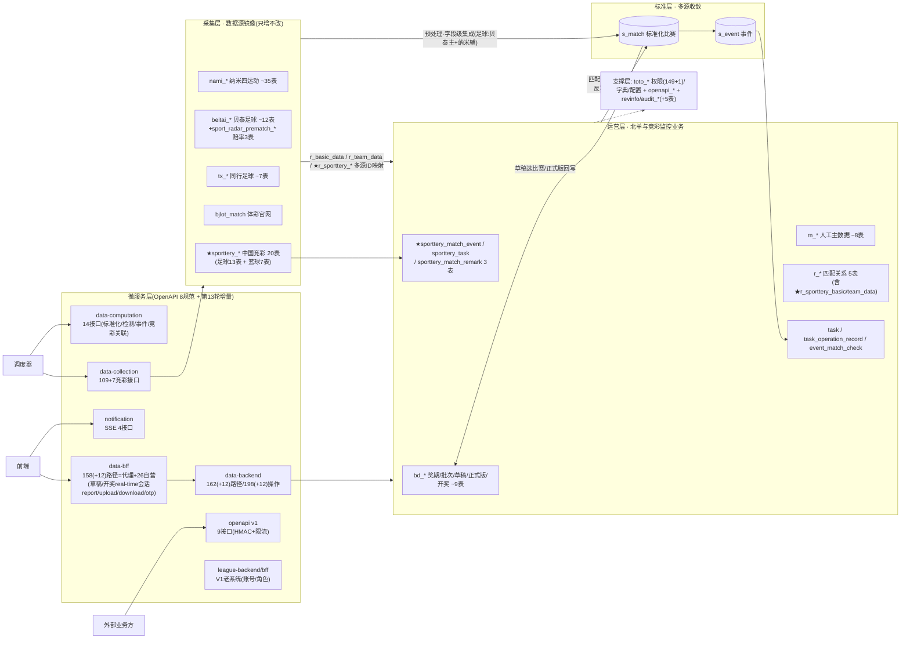
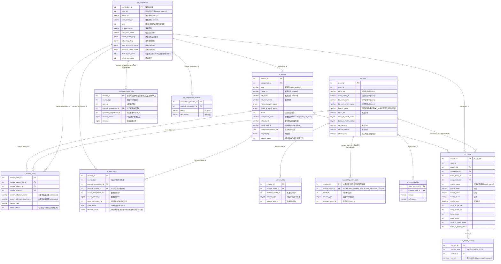
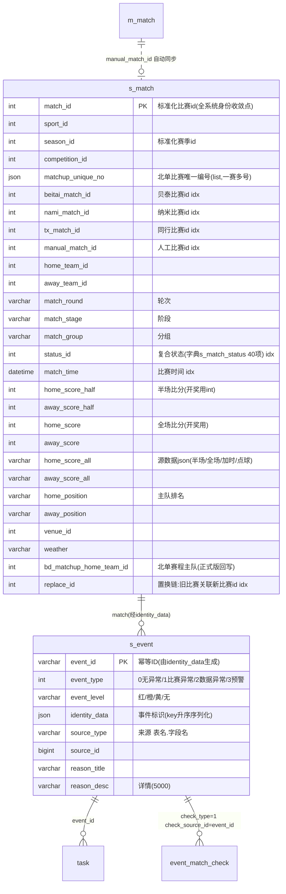
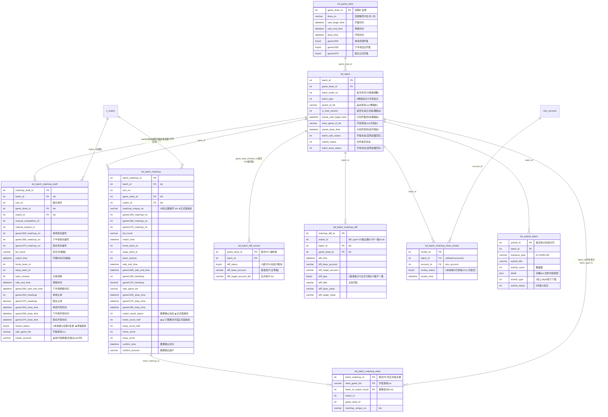
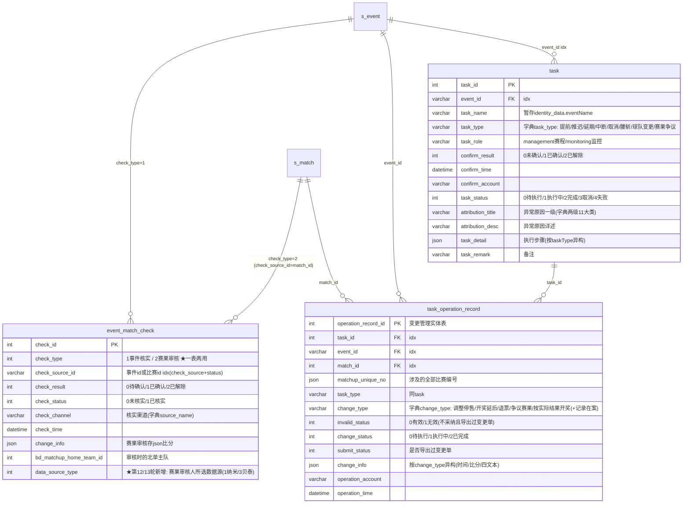
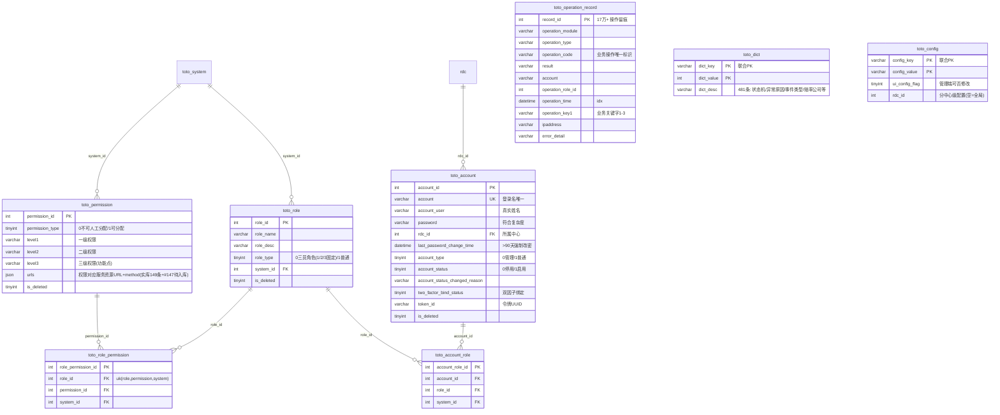
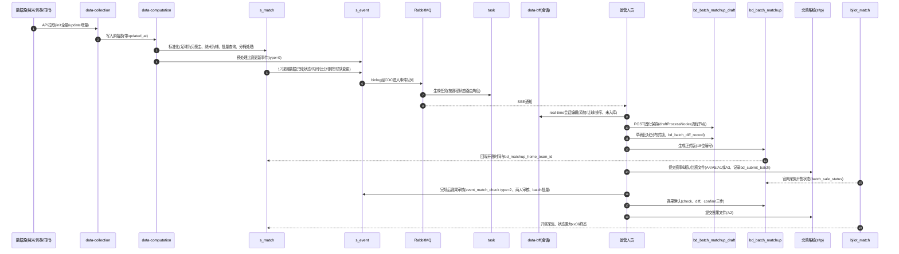

# 竞猜赛事运营系统 · ER 图（基于 test2_newgoal 真实表结构 · 第 13 轮冲刺同步版）

> 依据：`database-docs/北单运营系统-test2_newgoal-202610261418.sql` DDL（187 张表，较 2026-09-17 新增 34 张、修改 4 张）+ `第十三轮冲刺竞彩抓取数据库设计和变更.md` + `竞彩数据采集模块设计文档-第五段是数据库设计.md` + 实库 `test2_newgoal`（279 张表，2026-10-26 连库核验）+ `api-docs/league-core-api` 八份 OpenAPI 规范交叉验证。
> 说明：全库无物理外键，图中连线均为**逻辑外键**（应用层维护的引用关系）；仅绘制业务有效表（排除 ~51 张 `audit_*` 审计表与 ~48 张 `*_bak`/`z_*`/`zbk1_*`/`zz_*` 备份临时表）。
> 查看方式：任何支持 mermaid 的 Markdown 渲染器（IDEA/VSCode/GitLab/GitHub）。

---

## 图 0 · 总览：四层分域、微服务与核心数据流（含第 13 轮中国竞彩域）

---

## 图 1 · 主数据域：赛事-赛季-球队与四源匹配（m_* + r_* + ★r_sporttery_* + 黑名单）

## 图 2 · 标准层：s_match 四源收敛 + 事件

## 图 3 · 北单赛程域：奖期→批次→草稿→比对→正式版→赛果批次→提交

## 图 4 · 事件-任务-变更域

## 图 5 · 权限支撑域

## 图 6 · 采集层：纳米/同行/贝泰/SportRadar/体彩官网表族（以足球为例）

```mermaid
erDiagram
    nami_football_category ||--o{ nami_football_competition : "category_id"
    nami_football_category ||--o{ nami_football_country : "category_id"
    nami_football_competition ||--o{ nami_football_season : "competition_id"
    nami_football_competition ||--o{ nami_football_competition_rule : "competition_id"
    nami_football_competition ||--o{ nami_football_competition_table_detail : "competition_id"
    nami_football_season ||--o{ nami_football_stage : "season_id"
    nami_football_season ||--o{ nami_football_match : "season_id"
    nami_football_season ||--o{ nami_football_competition_table_detail : "season_id"
    nami_football_team ||--o{ nami_football_match : "home_team_id/away_team_id"
    nami_football_venue ||--o{ nami_football_match : "venue_id"
    nami_football_match ||--o| nami_football_match_live : "match_id"
    nami_football_match ||--o{ nami_football_europe_odds : "match_id"
    nami_football_match ||--o{ nami_football_odds : "match_id"
    nami_football_match ||--o| nami_football_match_analysis : "match_id"
    nami_football_europe_odds_company ||--o{ nami_football_europe_odds : "company_id"
    nami_football_team ||--o{ nami_football_table_live : "team_id"

    tx_competition ||--o{ tx_season : "competition_id"
    tx_season ||--o{ tx_stage : "season_id"
    tx_competition ||--o{ tx_match : "competition_id"
    tx_team ||--o{ tx_match : "home_team_id/away_team_id"

    beitai_football_tournament ||--o{ beitai_football_season : "tournament_id"
    beitai_football_season ||--o{ beitai_football_stage : "season_id"
    beitai_football_tournament ||--o{ beitai_football_team : "tournament_id"
    beitai_football_match ||--o| beitai_football_match_live : "match_id"
    beitai_football_match ||--o{ beitai_football_event : "match_id"
    beitai_football_match ||--o{ beitai_football_period : "match_id"
    beitai_football_match ||--o{ sport_radar_prematch_european_odds : "sport_event_id"
    beitai_football_match ||--o{ sport_radar_prematch_asian_handicap_odds : "sport_event_id"
    beitai_football_standing_snapshot ||--o{ beitai_football_standing_snapshot_item : "snapshot_id"

    beitai_football_match {
        int match_id PK
        int tournament_id
        int season_id
        varchar status "live/abandoned/cancelled/closed/ended/not_started/postponed"
        varchar live_match_status "live接口状态"
        varchar effective_match_status "有效状态(live优先)"
        int replaced_by "替补赛程ID(延期重排新比赛)"
        int home_virtual "主队占位"
        int away_virtual "客队占位"
        datetime resumetime "延期恢复时间"
        varchar coverage_scores "★第13轮新增: 比分更新方式(live实时/post赛后)"
    }
    sport_radar_prematch_european_odds {
        bigint id PK "★第13轮实库21.5万行: SportRadar赛前欧赔"
        int sport_event_id "关联比赛ID"
        int bookmaker_id "博彩公司ID"
        decimal home_win_odds
        decimal draw_odds
        decimal away_win_odds
    }
    sport_radar_prematch_asian_handicap_odds {
        bigint id PK "★第13轮实库110.6万行: SportRadar赛前亚盘"
        int sport_event_id "关联比赛ID"
        int bookmaker_id "博彩公司ID"
        varchar line "盘口线"
        decimal home_odds
        decimal away_odds
    }
    beitai_football_standing_snapshot {
        bigint id PK "事实+投影双表设计"
        bigint season_id
        int tournament_id
        json team_data "全部球队数据(事实源)"
        varchar snapshot_hash "SHA-256完整性校验"
    }
    beitai_football_standing_snapshot_item {
        bigint id PK "查询投影"
        bigint snapshot_id FK
        varchar standing_type "TOTAL/HOME/AWAY"
        bigint team_id
        int team_rank
        int points
    }
    nami_football_match {
        int match_id PK
        int season_id
        int competition_id
        int home_team_id
        int away_team_id
        int status_id "字典nami_football_match_status 0-13"
        bigint match_time "时间戳(秒)"
        json home_scores "比分list"
        json away_scores
        int round_stage_id "轮次-阶段id"
        int round_group_num "第几组"
        int round_round_num "第几轮"
        int team_reverse "主客相反"
        int tbd "时间待定"
        int related_id "双回合另一场"
        json agg_score "双回合总比分"
        bigint updated_at "纳米更新时间(秒)"
    }
    nami_football_deleted {
        varchar deleted_type PK "联合PK 通告表"
        int id PK "1分类/2球队/4赛事/5阶段/6赛季/7场馆/8比赛/9球员"
    }
    tx_match {
        int match_id PK
        int competition_id
        bigint match_date "时间戳(毫秒)"
        bigint season_id
        bigint stage_id
        int status "字典tx_match_status 0-17"
        json score "常规比分"
        varchar half "半场"
        json score_all "含加时"
        json score_point "点球"
        int valid_game "1正常/0异常"
    }
    bjlot_match {
        int draw_id PK "联合PK 体彩官网回读"
        int matchup_no PK "场次编号"
        varchar draw_no "奖期编号"
        varchar matchup_unique_no "比赛唯一编号"
        varchar bj_match_status "赛程状态"
        json sp "sp值"
    }
```

---

## 图 6B · 第 13 轮新增：中国竞彩（Sporttery）全链路分域 ER 图（采集 20 表 + 匹配 2 表 + 监控事件/任务/备注 3 表）

```mermaid
erDiagram
    sporttery_football_league ||--o{ sporttery_football_match : "league_id"
    sporttery_football_team ||--o{ sporttery_football_match : "home_team_id / away_team_id"
    sporttery_football_match ||--o| sporttery_football_had_odds : "match_id(最新胜平负)"
    sporttery_football_match ||--o| sporttery_football_hhad_odds : "match_id(最新让球胜平负)"
    sporttery_football_match ||--o| sporttery_football_crs_odds : "match_id(最新比分)"
    sporttery_football_match ||--o| sporttery_football_ttg_odds : "match_id(最新总进球)"
    sporttery_football_match ||--o| sporttery_football_hafu_odds : "match_id(最新半全场)"
    sporttery_football_match ||--o{ sporttery_football_had_odds_record : "match_id+release_time(历史)"
    sporttery_football_match ||--o{ sporttery_football_hhad_odds_record : "match_id+release_time(历史)"
    sporttery_football_match ||--o{ sporttery_football_crs_odds_record : "match_id+release_time(历史)"
    sporttery_football_match ||--o{ sporttery_football_ttg_odds_record : "match_id+release_time(历史)"
    sporttery_football_match ||--o{ sporttery_football_hafu_odds_record : "match_id+release_time(历史)"

    sporttery_basketball_league ||--o{ sporttery_basketball_match : "league_id"
    sporttery_basketball_team ||--o{ sporttery_basketball_match : "home_team_id / away_team_id"
    sporttery_basketball_match ||--o| sporttery_basketball_mnl_odds : "match_id(最新胜负)"
    sporttery_basketball_match ||--o| sporttery_basketball_hdc_odds : "match_id(最新让分胜负)"
    sporttery_basketball_match ||--o| sporttery_basketball_hilo_odds : "match_id(最新大小分)"
    sporttery_basketball_match ||--o| sporttery_basketball_wnm_odds : "match_id(最新胜分差)"

    m_competition ||--o{ r_sporttery_basic_data : "manual_competition_id(单选)"
    sporttery_football_league ||--o| r_sporttery_basic_data : "sporttery_competition_id(sport_id=1)"
    sporttery_basketball_league ||--o| r_sporttery_basic_data : "sporttery_competition_id(sport_id=2)"

    m_team ||--o{ r_sporttery_team_data : "manual_team_id(单选/多选)"
    sporttery_football_team ||--o{ r_sporttery_team_data : "sporttery_team_id(sport_id=1)"
    sporttery_basketball_team ||--o{ r_sporttery_team_data : "sporttery_team_id(sport_id=2)"

    s_match ||--o{ sporttery_football_match : "s_match_id(关联标准比赛)"
    s_match ||--o{ sporttery_basketball_match : "s_match_id(关联标准比赛)"
    sporttery_football_match ||--o{ sporttery_match_event : "source_id(sport_id=1)"
    sporttery_basketball_match ||--o{ sporttery_match_event : "source_id(sport_id=2)"
    sporttery_match_event ||--o{ sporttery_task : "event_id"
    sporttery_football_match ||--o{ sporttery_match_remark : "match_id(sport_id=1)"
    sporttery_basketball_match ||--o{ sporttery_match_remark : "match_id(sport_id=2)"

    sporttery_football_league {
        int league_id PK "实库77条"
        varchar league_name "赛事全称"
        varchar league_name_abbr "赛事简称"
        varchar league_back_color "底色"
    }
    sporttery_football_team {
        int team_id PK "实库1124条"
        varchar team_name "球队全称"
        varchar team_name_abbr "球队简称"
        varchar team_All_en_name "英文全称"
    }
    sporttery_football_match {
        bigint match_id PK "实库20617条: 竞彩足球比赛ID"
        bigint s_match_id FK "我方标准比赛ID(idx_s_match_id)"
        varchar match_num_str "周几+编号(如周一001)"
        int match_num "场次号(如1001)"
        varchar match_date "比赛日"
        datetime match_start_time "开赛时间(idx)"
        int league_id FK
        int home_team_id FK
        int away_team_id FK
        int sell_status "0待开售/1在售/2停售/3已开奖"
        varchar match_status "竞彩赛事状态"
        int home_half_score
        int away_half_score
        int home_score
        int away_score
        varchar had_combination_desc "胜平负彩果"
        varchar hhad_combination_desc "让球胜平负彩果"
        int if_change "是否队伍变动:0否/1是"
    }
    sporttery_basketball_match {
        bigint match_id PK "实库10727条: 竞彩篮球比赛ID"
        bigint s_match_id FK "我方标准比赛ID(idx_s_match_id)"
        varchar match_num_str "周几+编号"
        int match_num "场次号"
        datetime match_start_time "开赛时间(idx)"
        int league_id FK
        int home_team_id FK
        int away_team_id FK
        int sell_status "0待开售/1在售/2停售/3已开奖"
        varchar part_end "全场比分(注意格式=客队:主队)"
        int away_score "★第13轮新增: 客队全场比分(part_end左值)"
        int home_score "★第13轮新增: 主队全场比分(part_end右值)"
        int if_change "是否队伍变动:0否/1是"
    }
    sporttery_match_event {
        varchar event_id PK "幂等ID(11位)"
        int event_type "0无异常/1比赛异常/2数据异常/3预警"
        varchar event_level "红/橙/黄/无"
        json identity_data "事件唯一标识JSON"
        varchar source_type "固定SPORTTERY"
        bigint source_id "竞彩match_id"
        int sport_id "1足球/2篮球"
        bigint s_match_id "关联标准比赛ID"
        int event_code "事件编码"
        varchar reason_title "原因概述"
        varchar reason_desc "原因详述(5000)"
        json notification_data "通知展示数据"
    }
    sporttery_task {
        int task_id PK
        varchar event_id FK "idx_st_event_id"
        varchar task_name
        varchar task_type "提前/推迟/中断/取消/腰斩/球队变更"
        varchar task_role "monitoring监控等"
        int confirm_result "0未确认/1已确认/2已解除"
        int task_status "0待执行/1执行中/2完成/3取消/4失败"
    }
    sporttery_match_remark {
        int remark_id PK
        int sport_id "uk_sptty_user_remark(sport_id,remark_type,match_id,create_account)"
        int remark_type "3比赛监控"
        int match_id FK "竞彩比赛ID"
        varchar remark "备注(300)"
        varchar create_account
    }
```

---

## 图 7 · 核心生命周期时序（补充：数据如何流经各表与服务）

