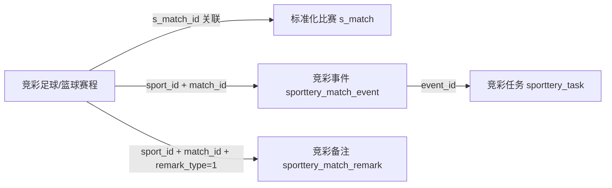
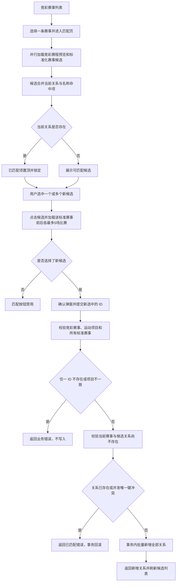
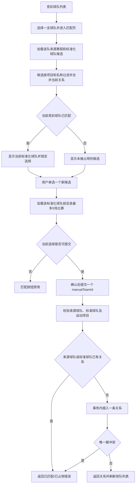

# 竞彩管理详细设计文档

## 1. 文档变更历史

| 版本 | 日期 | 作者 | 修改内容 |
| --- | --- | --- | --- |
| 1.0.0 | 2026-10-16 | 陈鹏翔 | 新建 |
| 1.0.1 | 2026-10-16 | 陈鹏翔 | 精简赛事与球队章节，仅保留接口总览；将各自匹配流程并入对应章节；调整后续章节编号和引用。 |
| 1.0.2 | 2026-10-16 | 陈鹏翔 | 增加项目背景和 PBL 需求说明，列明 PBL-632、PBL-633 的范围及核心业务要求；顺延章节编号并更新交叉引用。 |
| 1.0.3 | 2026-10-16 | 陈鹏翔 | 按要求移除共性需求、目标与范围、预览数据关系小节，以及需求差异、代码核对、验收和参考代码章节；调整剩余章节编号及交叉引用。 |
| 1.0.4 | 2026-10-19 | 陈鹏翔 | 根据《竞彩赛程监控接口设计》增加 PBL-634 需求、数据关系、查询/备注处理、服务边界、BFF 路由及现有比赛进程接口兼容说明。 |

## 2. 背景

平台已接入 Sporttery 足球、篮球的赛事、球队和赛程数据，并在 `m_competition`、`m_team`、`s_match` 中维护标准化赛事、球队和比赛。两类数据来自不同的数据源，名称和对象 ID 不同，运营人员需要在管理端核对来源信息与标准化对象并维护关联关系，供后续赛事和球队数据处理使用。运营人员还需要按业务日期查看竞彩赛程、标准化比赛进程、竞彩异常事件及处理任务，并记录本人的比赛监控备注。

仅凭名称难以判断同名赛事或球队是否指向同一业务对象，因此匹配页面需要同时展示竞彩来源赛程、标准化候选和标准化比赛预览。名称检索用于缩小候选范围，最终关联由运营人员确认。当前仓库已有 Sporttery 来源数据模型和标准化赛事查询，但竞彩赛事/球队管理接口及关系表、竞彩监控事件/任务/备注模型与接口仍需按本设计补充；本设计明确目标接口、匹配规则和实现边界。

## 3. 需求说明

| PBL | 需求名称 | 需求范围 |
| --- | --- | --- |
| PBL-632 | 竞彩赛事管理 | 查询竞彩赛事列表；查看该赛事的竞彩赛程；查询当前运动项目下的标准化赛事候选及已有匹配；预览候选赛事的标准化比赛；多选并新增赛事匹配关系。 |
| PBL-633 | 竞彩球队管理 | 查询竞彩球队列表；查看该球队的竞彩赛程；查询标准化球队候选及占用/已有匹配状态；预览候选球队的标准化比赛；单选并新增球队匹配关系。 |
| PBL-634 | 竞彩赛程监控 | 按运动项目和业务日期查询足球、篮球赛程；查看标准化比赛状态、排名、比分及进程；查看竞彩事件和关联任务；查询并保存当前用户的比赛监控备注。 |

## 4. 术语与共用规则

| 名称 | 含义 |
| --- | --- |
| 竞彩赛事/球队 | Sporttery 来源的赛事或球队记录，ID 来自竞彩来源表 |
| 标准化赛事/球队 | 平台维护的 `m_competition` / `m_team` 记录 |
| 竞彩比赛 | `sporttery_football_match` / `sporttery_basketball_match` 中的来源赛程 |
| 标准化比赛 | `s_match` 中的平台比赛 |
| 竞彩事件 | `sporttery_match_event` 中按运动项目和竞彩比赛来源 ID 归属的监控事件 |
| 竞彩任务 | `sporttery_task` 中关联竞彩事件的处理任务；本期只读 |
| 竞彩备注 | `sporttery_match_remark` 中按运动项目、竞彩比赛、备注类型和账号隔离的用户备注 |
| 当前匹配 | 当前竞彩赛事/球队与标准化赛事/球队之间的关系记录 |
| `sportId` | 运动项目 ID；足球为 `1`，篮球为 `2` |
| `source_type` | 来源类型；竞彩来源由服务端固定写入 `4`，客户端不传 |

## 5. 数据模型与关联约束

### 5.1 数据表职责

| 数据 | 主要用途 | ID 类型 |
| --- | --- | --- |
| `sporttery_football_league`、`sporttery_basketball_league` | 竞彩赛事名称、更新时间及来源属性 | `league_id BIGINT` |
| `sporttery_football_team`、`sporttery_basketball_team` | 竞彩球队简称、全称及更新时间 | `team_id BIGINT` |
| `sporttery_football_match`、`sporttery_basketball_match` | 竞彩赛事/球队的来源赛程 | `match_id BIGINT` |
| `sporttery_match_event` | 竞彩监控事件；通过 `sport_id`、`source_id` 标识运动项目及来源比赛 | `event_id` 为 64 位十六进制内容身份，`source_id BIGINT` |
| `sporttery_task` | 竞彩事件处理任务；以 `event_id` 关联事件 | `task_id` 按表定义 |
| `sporttery_match_remark` | 竞彩比赛监控备注；本期固定 `remark_type=1` | `remark_id INT`，来源比赛 ID 为 `BIGINT` |
| `r_sporttery_basic_data` | 竞彩赛事到标准化赛事的关系，`source_type=4` | 来源 ID 为 `BIGINT`，标准赛事 ID 为 `INT` |
| `r_sporttery_team_data` | 竞彩球队到标准化球队的关系，`source_type=4` | 来源 ID 为 `BIGINT`，标准球队 ID 为 `INT` |
| `m_competition`、`m_team` | 标准化赛事和球队 | ID 为 `INT` |
| `s_match` | 标准化比赛预览 | ID 为 `INT` |

足球与篮球使用各自的来源表；服务端先校验 `sportId`，再选择对应的来源表和球队表。不得仅凭客户端提供的 ID 在不同运动项目表之间切换。

### 5.2 监控数据关系

## 6. 竞彩赛事管理

### 6.1 接口总览

| 接口 | 方法 | data-backend 路径 | BFF 路径 | 响应/说明 |
| --- | --- | --- | --- | --- |
| 查询竞彩赛事列表 | GET | `/sporttery/competition` | `/data-backend/sporttery/competition` | `CommonResultPageable<SportteryCompetitionListItem>` |
| 查询竞彩赛程预览 | GET | `/relations/sporttery/competition/source-matches` | `/data-backend/relations/sporttery/competition/source-matches` | `CommonResult<List<SportterySourceMatchPreviewItem>>` |
| 查询标准化赛事候选 | GET | `/relations/sporttery/competition/manual-competitions` | `/data-backend/relations/sporttery/competition/manual-competitions` | `CommonResult<List<SportteryManualCompetitionCandidate>>`；按 PRD 合并当前关系与候选，不分页 |
| 查询标准化赛事比赛预览 | GET | `/relations/sporttery/competition/match-preview` | `/data-backend/relations/sporttery/competition/match-preview` | `CommonResult<List<SportteryStandardMatchPreviewItem>>` |
| 匹配竞彩赛事 | POST | `/relations/sporttery/competition` | `/data-backend/relations/sporttery/competition` | `CommonResult<SportteryCompetitionMatchResult>`；同批新增为一个事务 |

现有 `GET /m-competition` 仍提供标准化赛事分页检索，但不能单独满足本页面“已匹配关系与候选合并、已匹配项锁定、不分页”的 PRD 要求。新设计增加专用候选接口；该接口尚未在当前代码中实现。原赛事接口设计稿中的复用方案可作为检索能力参考，不作为该页面最终交互契约。

### 6.2 赛事匹配执行流程

赛事匹配是人工多选。名称检索只过滤标准化赛事候选；竞彩赛程和标准化比赛预览帮助用户核对赛事，不会自动选中候选或产生比赛级映射。

关键规则：

*   候选按当前 `sportId` 限定，名称检索覆盖标准化赛事简称、中文全称和英文名称并忽略英文大小写；结果不分页。
    
*   当前已匹配项无论是否命中查询词都要返回并锁定，排在候选前面；其余候选按标准化赛事简称排序。
    
*   当前竞彩赛事已匹配的标准化赛事始终显示且不可取消；前端提交本次新增项，不提交锁定项。
    
*   一批中任一标准化赛事无效、运动项目不一致或关系已存在时，整批拒绝；不得部分写入。
    
*   同一标准化赛事可以关联其他竞彩赛事；冲突校验针对当前竞彩赛事与当前候选这一对关系。
    
*   赛事列表匹配状态在至少存在一条关系时为已匹配。
    

候选集合和写入校验规则见本节；通用时间、关系及响应约定见第 4、5 节；接口路径和响应类型见本章 6.1。

## 7. 竞彩球队管理

### 7.1 接口总览

| 接口 | 方法 | data-backend 路径 | BFF 路径 | 响应 |
| --- | --- | --- | --- | --- |
| 查询竞彩球队列表 | GET | `/sporttery/team` | `/data-backend/sporttery/team` | `CommonResultPageable<SportteryTeamListItem>` |
| 查询竞彩球队赛程预览 | GET | `/relations/sporttery/team/source-matches` | `/data-backend/relations/sporttery/team/source-matches` | `CommonResult<List<SportteryTeamSourceMatchItem>>` |
| 查询标准化球队候选 | GET | `/relations/sporttery/team/manual-teams` | `/data-backend/relations/sporttery/team/manual-teams` | `CommonResult<List<SportteryManualTeamCandidate>>` |
| 查询标准化球队比赛预览 | GET | `/relations/sporttery/team/match-preview` | `/data-backend/relations/sporttery/team/match-preview` | `CommonResult<List<StandardTeamMatchPreviewItem>>` |
| 匹配竞彩球队 | POST | `/relations/sporttery/team` | `/data-backend/relations/sporttery/team` | `CommonResult<SportteryTeamMatchResult>` |

### 7.2 球队匹配执行流程

球队匹配是人工单选。候选查询同时标记当前关系和被其他竞彩球队占用的标准化球队；只有未占用项可作为新选择。

关键规则：

*   标准化球队候选限定当前 `sportId`，名称检索覆盖简称、中文全称和英文全称；来源竞彩球队只有简称和全称，没有英文名称字段。
    
*   当前关系即使不命中关键词也要返回并锁定；被其他竞彩球队占用的标准化球队不作为可选项；结果不分页，先显示当前匹配项，再按简称及球队 ID 排序。
    
*   当前关系存在时，该候选保持选中且不可取消；本期没有换队或解绑接口。
    
*   服务层先查询两侧占用状态，数据库两个唯一约束处理并发竞争。
    
*   唯一键冲突转换为业务错误；不得向前端暴露数据库错误详情。
    

球队候选和写入校验规则见本节；通用时间、关系及响应约定见第 4、5 节；接口路径和响应类型见本章 7.1。四类预览均为只读查询，不参与自动匹配评分，也不写入 `s_match` 或比赛级关联表。

## 8. 竞彩赛程监控

详细参数、字段定义和请求/响应示例以《竞彩赛程监控接口设计》为接口契约。本章说明数据组织、关键查询规则、写入边界及现有能力复用要求。

### 8.1 接口总览

| 接口 | 方法 | data-backend 路径 | BFF 路径 | 用途 |
| --- | --- | --- | --- | --- |
| 竞彩赛程监控列表 | GET | `/sporttery/match-monitor` | `/data-backend/sporttery/match-monitor` | 查询足球、篮球竞彩赛程及汇总字段 |
| 比赛进程 | GET | `/sporttery/match-monitor/live` | `/data-backend/sporttery/match-monitor/live` | 查询标准化比赛关联的纳米、贝泰进程 |
| 竞彩比赛事件 | GET | `/sporttery/match-monitor/events` | `/data-backend/sporttery/match-monitor/events` | 分页查询单场竞彩事件和最新关联任务 |
| 竞彩比赛备注 | GET | `/sporttery/match-monitor/remarks` | `/data-backend/sporttery/match-monitor/remarks` | 查询单场备注并将当前用户备注置顶 |
| 保存竞彩备注 | POST | `/sporttery/match-monitor/remark` | `/data-backend/sporttery/match-monitor/remark` | 新增或更新当前用户的监控备注 |

列表查询默认 `sportIds=[1,2]`、业务日期为当天至未来第 6 日，日期区间为闭区间。列表不分页；事件详情从 0 开始分页，单页最大 100 条。成功响应使用 `code=0`，参数或业务校验失败为 `2`，未预期服务异常为 `31`。

### 8.2 赛程列表查询与组装

1.  按 `sportId` 分别查询足球或篮球来源表，以 `business_date` 索引限定日期；来源赛程作为主表，赛事表、球队表及 `s_match` 均使用左关联。两类结果在服务层统一字段后合并。
    
2.  竞彩编号、业务日、开赛时间、赛事名和队名以 Sporttery 来源表为准。队伍全称为空时回退简称；标准化比赛未匹配时，状态为 `UNMATCHED`，排名、标准化比分及数据源比赛 ID 为空，但赛程、事件和备注仍可查询。
    
3.  标准化状态从 `SMatchStatus` 映射；足球处于比赛中时按现有贝泰直播时钟规则显示分钟或阶段文案，篮球沿用基础状态文案。
    
4.  `sell_status=3` 时优先使用竞彩开奖比分：足球取半场/全场比分，篮球取各节及终场比分。其他销售状态使用 `s_match` 采集比分。`if_change=1` 时交换排名及比分两侧；无比分或异常占位比分返回空值，由页面显示 `-`。
    
5.  事件数按 `(sport_id, source_id)` 统计；备注数按 `(sport_id, match_id, remark_type=1)` 统计。采用分组批量查询并回填，不在每场赛程循环中逐条查询。
    
6.  按竞彩编号数字部分升序；无法解析编号的记录排在末尾，同号按官方 `match_id` 稳定排序。`match_time` 为空的异常记录保留并排在正常开赛时间之后。
    

行背景色取最新的未解除竞彩事件：按事件 `update_time DESC,event_id DESC` 选取，再以关联任务 `task_type` 映射颜色。`confirm_result=2` 的事件不参与颜色计算；没有任务的事件视为未解除。比赛提前为红色、推迟为黄色、取消/中断/腰斩为橙色、球队变更为绿色，其他或无事件为无背景。颜色由最新事件决定，不再按颜色优先级重新排序。

### 8.3 事件与任务只读

事件查询必须同时限制 `sport_id`、竞彩官方 `source_id` 和 `source_type='SPORTTERY'`，不混入北单事件或标准化事件；事件按 `create_time DESC,event_id DESC` 排序。任务通过 `event_id` 关联；若历史数据为同一事件保存了多条任务，只返回 `task_id` 最大的一条，避免事件重复。

事件响应保留事件身份、类型/级别、原因、`identity_data` 快照、通知信息、创建/更新时间及关联任务。任务字段包括确认结果、任务状态、任务类型、责任归属、执行详情和备注。`confirm_result` 值为 0 未确认、1 已确认、2 已解除；`task_status` 值为 0 待执行、1 执行中、2 已完成、3 已取消、4 失败。该页面只展示处理信息，不接收客户端修改任务状态、确认人或通知投递状态。