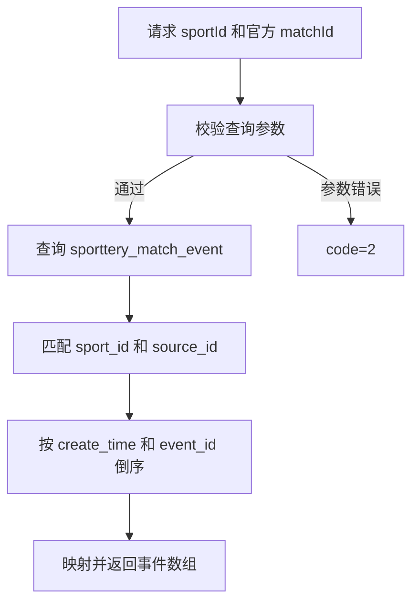

# 竞彩比赛事件查询接口分析

> operation：`GET /sporttery/match-monitor/events`，`operationId=listEvents`
> 分析状态：主体口径已确认；参数异常按用户确认的“接口报错即可”处理，具体状态和文案不固化。
> 测试方案就绪：是；合法参数测试点 1～22 已在开发环境执行，参数异常自动化仍待补充。

## 1. 接口定位与结论摘要

该接口为竞彩赛程监控的事件弹窗提供事件列表。调用方传入运动项目和竞彩官方比赛 ID，从 `sporttery_match_event` 读取事件 ID、事件时间、标题和异常详情，其中标题取 `event_name`、时间取 `create_time`、异常详情取 `reason_desc`。

用户确认事件查询不分页，返回全部匹配事件；新版 OpenAPI 与该口径一致，事件按创建时间和事件 ID 倒序，没有匹配事件按已确认的集合语义返回 `data=[]`。本地代码快照的标题字段映射曾存在差异；2026-11-03 开发环境自动化已验证响应按 `event_name` 返回，不能据此推断本地源码和部署版本完全一致。

## 2. 分析范围与依据

### 2.1 分析范围

本次只分析 `listEvents` operation：请求参数、参数校验、事件数据路径、过滤、排序、响应字段、空结果和只读边界。事件查询不分页，不以 `page`、`size` 设计分页参数测试。

以下内容不属于本接口契约：

- 点击列表事件、弹窗打开/关闭和弹窗视觉样式；
- 列表行事件计数和背景颜色；
- 自动刷新、列筛选和滚动位置；
- 任务确认、任务执行和事件写入；
- 旧 `/s-match` 接口的 `s_event`、开售前/开售后时间窗口及历史审核条件。

### 2.2 来源与用途

| 来源 | 用途 | 证据性质 |
|---|---|---|
| [当前模块需求与 RSU-012](../../preanalysis/02-sentence-test-point-map.md) | 事件弹窗展示字段和倒序要求 | 当前需求原文 |
| [模块问题确认清单](../../preanalysis/03-clarification-questions.md) | Q-003 空值语义；Q-004 事件表、展示字段及本轮范围 | 用户已确认口径 |
| [模块 Context Pack](../../preanalysis/01-context-pack.md) | 当前接口链路、官方 ID 域和旧接口排除范围 | 模块级已确认上下文 |
| [模块 DC-003](../../preanalysis/data-closures/DC-003-事件查询数据闭包.md) | 事件表、字段映射、过滤和清理边界 | 可复用数据闭包 |
| [当前 OpenAPI operation](../../../../../global/source-materials/api-docs/league-api-definition/league-core-api/data-backend-openapi.json) | `/paths/~1sporttery~1match-monitor~1events/get` 与事件列表 schema | 传输契约；已更新为数组，但不声明数据库字段映射 |
| [Vegas2.0 接口错误码](../../../../../global/source-materials/api-docs/Vegas2.0接口错误码.md) | 通用业务错误码：`2` 为参数错误 | 通用码定义；不逐项定义本接口的参数校验边界或 HTTP 状态 |
| [竞彩管理详细设计](../../../../../global/source-materials/api-docs/竞彩管理详细设计文档.md) | 旧版事件设计，供来源差异对照 | 用户已确认事件快照及关联任务描述为旧口径 |
| [本地 Controller](../../../../../../../apps/league-platform/data-backend/src/main/java/com/league/backend/controller/sporttery/SportteryMatchMonitorController.java) | `listEvents` 的现有请求和响应 | 开发中代码快照，不代表部署状态 |
| [本地 Service](../../../../../../../apps/league-platform/data-backend/src/main/java/com/league/backend/service/sporttery/SportteryMatchMonitorService.java) | `listEvents` 的现有校验、过滤与字段映射 | 实现观察，不作为字段预期 |
| [本地 Repository](../../../../../../../apps/league-platform/coredb-repo/src/main/java/com/league/coredb/repository/SportteryMatchEventRepository.java) | 现有单表过滤和排序 | 实现观察 |
| [事件实体](../../../../../../../apps/league-platform/coredb-entity/src/main/java/com/league/coredb/entity/SportteryMatchEventEntity.java) | 物理字段、可空性和 ID 类型 | 数据结构/实现证据 |
| [事件表 DDL](../../../../../global/source-materials/database-docs/北单运营系统-test2_newgoal-202610261418.sql) | `sporttery_match_event` 字段、索引和主键 | 当前 DDL |

### 2.3 复用与接口专属辅助产物

- 复用模块级 [DC-003 竞彩事件查询数据闭包](../../preanalysis/data-closures/DC-003-事件查询数据闭包.md)，它已经覆盖本接口所需的最小数据路径。
- 复用模块级 Context Pack；本接口没有需要跨多个来源重复消费的额外复杂上下文，因此不创建 API Context Card。
- API-003 专属问题清单见 [clarification-questions.md](./clarification-questions.md)。模块 Q-003、Q-004 及接口 Q-001～Q-003 的当前口径已记录；Q-001 不固定报错状态或文案。

## 3. 请求与接口契约

### 3.1 调用路径

OpenAPI operation 路径为：

```http
GET /sporttery/match-monitor/events
```

管理端 BFF 调用路径为：

```http
GET /data-backend/sporttery/match-monitor/events
```

测试工程使用项目既有 DataBff client/session 封装调用，不在接口分析中记录账号、Cookie 或密码。

### 3.2 请求参数

| 参数 | 位置/类型 | 默认值 | 业务含义与约束 |
|---|---|---:|---|
| `sportId` | query / integer | 无 | 运动项目，OpenAPI 说明 `1=足球`、`2=篮球` |
| `matchId` | query / int64 | 无 | 竞彩官方比赛 ID，不是 `s_match.match_id` |

新版 OpenAPI 只列出上述两个请求参数，不含分页参数。

新版 OpenAPI 将这两个参数标记为 `required: false`；OpenAPI 和 Vegas2.0 通用错误码说明业务参数错误为 `code=2`，但未逐项列出校验边界。用户确认缺参、非法运动项目及非正数比赛 ID 等异常以接口报错为准，不要求固定状态码或文案；开发环境实际探测范围和观察见 Q-001。HTTP 类型绑定失败未实测。

### 3.3 参数与 ID 域边界

`matchId` 指竞彩官方来源表中的比赛 ID，对应事件表的 `source_id`，不等于标准化 `s_match.match_id`。本地旧实现直接按事件表查询，没有先解析 `sporttery_football_match` 或 `sporttery_basketball_match`；开发完成后仍需核对该行为。

`sportId` 必须始终参与查询。相同数值的 `source_id` 在足球和篮球中属于不同的查询范围，不能只按 `source_id` 查询。

## 4. 业务规则与数据处理流程

### 4.1 查询流程



处理顺序为：

1. 根据 `sportId` 和竞彩官方 `matchId` 确定查询范围：分别对应事件表的 `sport_id` 和 `source_id`。
2. 从 `sporttery_match_event` 获取对应事件。当前 DDL 将竞彩事件 `source_type` 标注为固定 `SPORTTERY`；本地旧 Repository 也额外按该值过滤。
3. 按 `create_time DESC, event_id DESC` 排序，按新版 OpenAPI 返回全部对应事件。
4. 根据用户确认的字段来源映射事件项，返回数组；空集合语义见模块 Q-003。

### 4.2 数据路径边界

- 本接口读取的是竞彩事件表，而不是历史比赛监控的 `s_event`；不沿用历史开售前/开售后时间窗口。
- 用户确认详细设计中事件快照与关联任务的描述是旧口径，不应把那些字段或任务去重规则加入本接口预期。
- 本地旧 Repository 是单表查询，没有关联 `sporttery_*_match` 或 `sporttery_task`，也没有按 `event_type`、`event_level` 或 `event_code` 过滤；这是本地代码观察，实际接口实现仍需核对。

### 4.3 时间和排序

事件时间排序使用数据库 `create_time`，不是 `update_time`，也不是事件业务快照中的其他时间字段。相同 `create_time` 时使用 `event_id DESC` 作为第二排序键；该次序来自新版 OpenAPI。

`event_id` 是字符串字段，当前排序语义是数据库对该字段的降序比较，不应在接口分析中擅自解释为数字大小或时间顺序。

### 4.4 数据缺失和集合语义

- 有符合范围的记录：新版 OpenAPI 声明 `data` 返回全部事件数组。
- 没有匹配记录：按模块 Q-003 成功返回 `code=0`、`message=OK`、`data=[]`。
- 事件项字段实际没有值时，按模块 Q-003 的已确认规则保留 `null`；用户另确认已存储的空字符串应原样返回，不转换为 `null`。当前 DDL 对 `event_id`、`create_time`、`event_name`、`reason_desc` 均定义为非空，正常受约束数据不应出现这些字段为数据库 `NULL` 的记录。

## 5. 响应字段与结果分支

### 5.1 成功响应包络

新版 OpenAPI 的成功响应为 `CommonResult<List<SportteryMatchEventItem>>`，空集合示意：

```json
{
  "code": 0,
  "message": "OK",
  "data": []
}
```

新版 schema 列出 `code`、`message`、`data`，其中 `data` 是事件数组；没有声明分页元数据。示意只说明已确认字段，不推断未声明字段在实际响应中必定不存在。

### 5.2 事件项字段

| 响应字段 | 数据来源 | 业务含义 | 空值/格式 |
|---|---|---|---|
| `eventId` | `sporttery_match_event.event_id` | 事件唯一标识 | 用户确认数据库 ID 非空时必须返回；按字符串原值返回，保留大小写；当前实体/DDL 为 `varchar(11)` |
| `eventTime` | `sporttery_match_event.create_time` | 事件创建时间 | 用户确认；OpenAPI 类型为 `date-time` |
| `title` | `sporttery_match_event.event_name` | 事件标题 | 用户最新更正；不能用 `reason_title` 替代 |
| `exceptionDetail` | `sporttery_match_event.reason_desc` | 异常详情 | 用户确认 |

OpenAPI 只列出上述四个事件项字段；其中数据库来源映射由用户确认，并非 OpenAPI 自身声明。事件表的 `event_name` 与 `reason_title` 是不同字段，本接口标题采用前者；列表行颜色的独立规则不因此变更。

### 5.3 分支表

| 分支 | `code` | `message` | `data` |
|---|---:|---|---|
| 合法参数，有记录 | `0` | `OK` | 对应事件数组 |
| 合法参数，无匹配记录 | `0` | `OK` | `[]` |
| 查询参数错误 | `2` | OpenAPI 未明确错误文案；本地旧实现为“竞彩比赛事件查询参数错误” | 新版错误响应未细化，后续需核对实际契约及接口返回 |

## 6. 职责边界与副作用

接口负责：

- 校验查询参数；
- 按官方比赛 ID 和运动项目查询竞彩事件；
- 按事件创建时间和事件 ID 倒序返回事件摘要字段。

接口不负责：

- 创建、更新或删除竞彩事件；
- 创建、确认、执行或修改事件任务；
- 计算列表行背景色或事件计数；
- 查询标准化比赛进程；
- 判断事件是否开售前/开售后；
- 控制前端事件链接是否置灰、弹窗是否显示或弹窗样式。

当前本地 Service 使用只读事务；作为查询接口，同一数据状态下重复调用不应新增或修改事件，也不应改变结果。实际实现和响应须在后续验证。

## 7. 来源差异、假设与待确认问题

### 7.1 已知来源差异

1. **标题映射**：用户最新更正 `title` 来自 `event_name`，取代先前的 `reason_title` 口径；当前本地 Service 的 `listEvents` 使用 `event.getReasonTitle()`，与确认口径不一致。实际接口返回尚未验证；新版 OpenAPI 没有声明数据库来源。
2. **响应方式**：已确认需求不分页，新版 OpenAPI 声明 `data` 为事件数组并返回全部事件；当前本地 Service 返回列表且不分页，与该口径一致，不能据此判断开发环境的实际部署。
3. **旧详细设计**：用户确认其中事件快照和关联任务描述为旧口径；当前 OpenAPI 的事件项只有 ID、时间、标题、异常详情，不把旧设计里的任务字段和去重规则加入预期。
4. **来源类型**：事件表 DDL 将 `source_type` 定义为字符串并注释为 `SPORTTERY`；本地旧 Service 使用同一字符串，详细设计的通用术语中还有数字 `4` 的描述。不能直接以数字 `4` 替代当前事件表的字符串来源值。
5. **事件 ID**：详细设计描述的内容身份长度与本地实体和 DDL 的 `varchar(11)` 不一致。当前接口以字符串返回，ID 生成及实际长度属于写入链路，不能仅凭旧设计扩展查询接口约束。

### 7.2 当前假设与资料缺口

- HTTP 参数类型无法绑定时的框架层响应不由当前 OpenAPI 明确定义；接口分析只确认业务层合法整数参数的行为。
- 开发环境中的具体官方比赛样本、事件 ID 和数据量不固定；后续自动化阶段应从数据库动态获取或由专用 helper 准备，不把样本 ID 写入本接口基线。
- 本地代码和开发环境可能处于不同版本；2026-11-03 的接口与开发库实际验证见自动化实施方案，不能代表其他环境。
- 模块级 DC-003 的当前状态为 `ready`，可支撑测试方案和后续自动化设计；具体造数和物理环境仍需在后续阶段确认。

### 7.3 问题清单

本接口专属问题清单见 [clarification-questions.md](./clarification-questions.md)。模块级 Q-003、Q-004 与本接口 Q-001～Q-003 的当前口径已回答；Q-001 的实际观察和自动化缺口在原问题处保留。

## 8. 测试方案交接

- 查询范围是 `sportId + 官方 matchId`，数据来源为 `sporttery_match_event`；不要以 `s_match.match_id` 或旧 `s_event` 替代。
- 标题、时间和异常详情分别来自 `event_name`、`create_time`、`reason_desc`；数组按 `create_time DESC, event_id DESC` 排序。
- 按模块 Q-003 处理空集合和字段空值，同时遵守当前 DDL 的非空约束；新版 OpenAPI 的参数边界和错误包络仍需结合开发完成后的契约核对。
- 不把旧版详细设计的任务或快照字段加入当前接口预期；按不分页、返回全部匹配事件的已确认口径设计方案，不设置分页参数测试。
- 后续阶段复用模块级 `DC-003`，不创建重复 API Data Closure。开发环境的执行范围和结果见自动化实施方案。

> 分析状态：主体已确认；参数异常采用 Q-001 的宽松错误预期。
> 测试方案就绪：是；参数异常自动化仍待补充。
