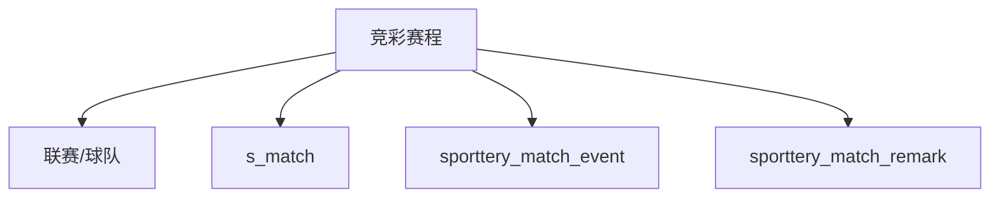

# DC-001 竞彩列表聚合数据闭包

## 引用入口

| 资源 ID | 可点击文件 | 用途 |
|---|---|---|
| SRC-MOD | [当前模块需求](../00-module-requirement-pack.md) | 列表字段和功能规则 |
| SRC-API-BACKEND | [当前 OpenAPI](../../../../../global/source-materials/api-docs/league-api-definition/league-core-api/data-backend-openapi.json) | 列表接口 |
| SRC-CODE-MONITOR | [当前服务](../../../../../../../apps/league-platform/data-backend/src/main/java/com/league/backend/service/sporttery/SportteryMatchMonitorService.java) | 查询和组装 |
| SRC-CODE-RULES | [规则类](../../../../../../../apps/league-platform/data-backend/src/main/java/com/league/backend/service/sporttery/SportteryMatchMonitorRules.java) | 比分、颜色、状态 |
| SRC-CODE-EVENT-REPO | [事件 Repository](../../../../../../../apps/league-platform/coredb-repo/src/main/java/com/league/coredb/repository/SportteryMatchEventRepository.java) | 事件计数和列表事件来源 |
| SRC-CODE-REMARK-REPO | [备注 Repository](../../../../../../../apps/league-platform/coredb-repo/src/main/java/com/league/coredb/repository/SportteryMatchRemarkRepository.java) | 备注计数和类型过滤 |
| SRC-DB13 | [数据库设计](../../../../../global/source-materials/database-docs/第十三轮冲刺竞彩抓取数据库设计和变更.md) | 竞彩表设计 |
| SRC-DB-SCHEMA | [最新 DDL](../../../../../global/source-materials/database-docs/北单运营系统-test2_newgoal-202610261418.sql) | 字段和约束 |

## 定位

- 状态：test-point-ready
- 本卡保存：竞彩赛程到标准比赛、事件、备注和列表派生字段的最小路径；任务表仅保留历史溯源，本期不使用。
- 本卡不保存：正式测试 SQL、环境账号和用例步骤。

## 关联范围

- 关联 RSU：RSU-001～RSU-010
- 关联问题：Q-002
- 关联功能上下文：FC-001

## 闭包目标

支持列表过滤、排序、空标准比赛、队序映射、排名、状态、比分、开奖、事件/备注计数和行颜色测试点。竞彩球队名称固定使用源赛程顺序；仅 s_match 来源数据按 if_change 对齐。事件详情来自竞彩事件表，不按开售时间筛选。

## 输入与输出

| 方向 | 逻辑对象 | 物理载体/字段 | 约束 | 依据 |
|---|---|---|---|---|
| 输入 | 足球/篮球竞彩赛程 | sporttery_*_match: match_id,s_match_id,business_date,match_no,league_id,home_team_id,away_team_id,match_time,sell_status,if_change,score fields | 业务日闭区间、官方 match_id为列表身份 | SRC-CODE-MONITOR、SRC-DB13 |
| 输入 | 联赛/球队 | sporttery_*_league、sporttery_*_team | 名称存在回退规则 | SRC-CODE-MONITOR |
| 输入 | 标准比赛 | s_match.match_id=s_match_id 且 sport_id一致 | 用户确认已替换时追随新比赛 ID；缺失保留源行；异常替换链待确认 | API-001 Q-003 |
| 输入 | 事件/备注 | sporttery_match_event、sporttery_match_remark | sport_id隔离，remark_type=1；本期不使用任务表 | API-001 Q-007、SRC-CODE-EVENT-REPO、SRC-CODE-REMARK-REPO |
| 输出 | SportteryMatchMonitorItem | 列表项字段 | matchNo数字化、matchTime null置后、matchId排序 | SRC-API-BACKEND、SRC-CODE-MONITOR |

## 关系图

## 表角色

| Table ID | 物理表 | 职责 | 访问模式 | 主键/自然键 | 关键字段 | 数据所有权 |
|---|---|---|---|---|---|---|
| T-001 | sporttery_football_match / sporttery_basketball_match | 列表主体 | 只读 | match_id | 日期、编号、联赛/球队、时间、销售、方向、官方比分 | 竞彩采集 |
| T-002 | sporttery_*_league / sporttery_*_team | 名称来源 | 只读 | ID | 简称/全称、球队名称 | 竞彩采集 |
| T-003 | s_match | 标准化补充 | 只读 | match_id | 状态、排名、比分、live IDs、replace_id | 标准化比赛 |
| T-004 | sporttery_match_event | 事件计数、颜色输入 | 只读 | event_id | sport_id、source_id、update_time、reason_title | 竞彩事件 |
| T-005 | sporttery_task | 历史设计记录，本期不使用 | 不访问 | task_id | event_id、task_type、confirm_result、update_time | 竞彩任务 |
| T-006 | sporttery_match_remark | 备注计数 | 只读 | remark_id/唯一用户键 | sport_id、match_id、remark_type | 用户备注 |

## 连接与过滤契约

| Edge ID | From | To | Join Predicate | 基数 | 附加过滤 | 依据 |
|---|---|---|---|---|---|---|
| E-001 | T-001 | T-003 | source.s_match_id=s_match.match_id AND sport_id一致；已替换时追随新 ID | 0..1 | 异常替换链待确认 | API-001 Q-003 |
| E-002 | T-001 | T-004 | event.sport_id=source.sport_id AND event.source_id=source.match_id | 0..N | 官方 match_id计数 | SRC-CODE-MONITOR、SRC-CODE-EVENT-REPO |
| E-003 | T-004 | T-005 | 历史事件/任务关联 | 0..N | 本期不使用，不按 confirm_result 过滤 | API-001 Q-007 |
| E-004 | T-001 | T-006 | remark.sport_id=source.sport_id AND remark.match_id=source.match_id AND remark_type=1 | 0..N | 不按 s_match_id | SRC-CODE-MONITOR、SRC-CODE-REMARK-REPO |

## 数据状态与准备契约

绿色背景场景使用 `reason_title="比赛方变更"`，按 [API-001 Q-011](../../interfaces/API-001-get-match-monitor/clarification-questions.md) 的最新确认准备，不沿用需求原文中的旧名称。

| Profile ID | 数据状态目标 | 准备策略 | 预期推导 | 清理策略 |
|---|---|---|---|---|
| DP-001 | 足球/篮球源比赛同业务日 | 复用 fixture或插入源和名称依赖 | 两运动项目均返回且按编号排序 | 删除唯一测试源数据 |
| DP-002 | 源比赛缺失标准比赛 | s_match_id为空或无对应记录 | 源行保留、标准字段为空、未匹配 | 删除源行 |
| DP-003 | if_change、开奖和比分来源矩阵 | 准备主客队可区分的源队名、标准排名/比分、官方比分与 sell_status | 名称保持竞彩源顺序；标准化来源按 if_change 映射；官方比分保持竞彩顺序 | 恢复/删除测试数据 |
| DP-004 | 事件/备注计数和颜色 | 在 sporttery_match_event 中构造目标赛程事件并按需准备备注，不准备任务 | 计数使用匹配记录；详情不加开售前后过滤；颜色按事件标题和更新时间，无事件为 NONE | 删除备注、事件 |

## 查询与断言契约

| 用途 | 查询入口 | 断言口径 | 空结果含义 | 依据 |
|---|---|---|---|---|
| 列表过滤 | GET /sporttery/match-monitor | sportIds和业务日含边界，非法参数code=2 | 无源数据data=[] | SRC-API-BACKEND |
| 列表派生 | Service + Rules | 一行一个官方match_id，score/status/color一致 | 标准缺失不丢行 | SRC-CODE-MONITOR、SRC-CODE-RULES |

## 清理与隔离

使用唯一业务日、官方 match_id 或账号前缀；删除顺序先备注，再事件和源比赛；共享 s_match、league/team 保存原值并恢复。

## 当前缺口

开发环境及登录账号已确认；具体比赛样本/造数方式在用例就绪阶段查询开发库并确定，关联 Q-002。密码不得写入产物。
