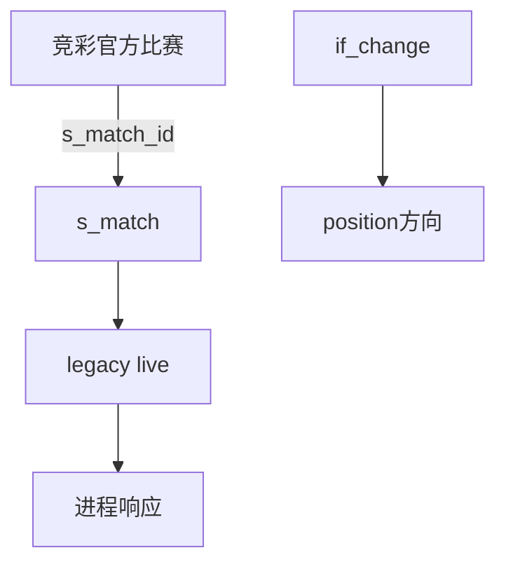

# DC-002 竞彩进程解析数据闭包

## 引用入口

| 资源 ID | 可点击文件 | 用途 |
|---|---|---|
| SRC-MOD | [当前模块需求](../00-module-requirement-pack.md) | 进程规则 |
| SRC-API-BACKEND | [当前 OpenAPI](../../../../../global/source-materials/api-docs/league-api-definition/league-core-api/data-backend-openapi.json) | 参数和响应 |
| SRC-CODE-MONITOR | [当前服务](../../../../../../../apps/league-platform/data-backend/src/main/java/com/league/backend/service/sporttery/SportteryMatchMonitorService.java) | 关联和翻转 |
| SRC-HIST-LIVE | [旧进程需求](../../../../../global/source-materials/automation-contracts/data-bff/match-monitoring/legacy-match-live/比赛进程信息需求.md) | 历史字段参考 |
| SRC-HIST-LIVE-SQL | [旧进程 SQL](../../../../../global/source-materials/automation-contracts/data-bff/match-monitoring/legacy-match-live/比赛进程信息查询接口.sql) | 历史来源参考 |
| SRC-DB13 | [数据库设计](../../../../../global/source-materials/database-docs/第十三轮冲刺竞彩抓取数据库设计和变更.md) | 竞彩关联字段 |

## 定位

- 状态：test-point-ready
- 本卡保存：sportId、sportteryMatchId、可选 matchId、s_match_id、竞彩源主客队顺序、if_change 与 live 数据最小路径。
- 本卡不保存：旧接口参数、环境账号和正式用例 SQL。

## 关联范围

- 关联 RSU：RSU-004、RSU-011
- 关联问题：Q-003
- 关联功能上下文：FC-002

## 闭包目标

支持进程参数校验、竞彩比赛存在性、标准比赛关联一致性、标准比赛存在性、按 if_change 对齐竞彩主客方向及无数据返回空数组的测试点。

## 输入与输出

| 方向 | 逻辑对象 | 物理载体/字段 | 约束 | 依据 |
|---|---|---|---|---|
| 输入 | 竞彩官方赛程 | sporttery_*_match.match_id/s_match_id/if_change | sportId决定表，sportteryMatchId正数 | SRC-CODE-MONITOR |
| 输入 | 标准比赛 | s_match.match_id | source.s_match_id存在，可选matchId一致 | SRC-CODE-MONITOR |
| 输入 | live来源 | s_match.beitai_match_id/nami_match_id与legacy live表 | 由 resolved live 服务定义过滤和空值 | SRC-CODE-MONITOR、SRC-HIST-LIVE-SQL |
| 输出 | 进程响应 | liveIncidents、beitaiLiveIncidents | 两个来源数组按 if_change 对齐竞彩赛程主客方向；无记录为 `[]`；数组元素具体字段缺值为 `null` | SRC-API-BACKEND、SRC-CODE-MONITOR、Q-003 |

## 关系图

## 表角色

| Table ID | 物理表 | 职责 | 访问模式 | 主键/自然键 | 关键字段 | 数据所有权 |
|---|---|---|---|---|---|---|
| T-001 | sporttery_football_match / sporttery_basketball_match | 请求解析 | 只读 | official match_id | s_match_id、if_change | 竞彩采集 |
| T-002 | s_match | 标准比赛路由 | 只读 | match_id | sport_id、live IDs、status | 标准化比赛 |
| T-003 | legacy live tables | 进程事件 | 只读 | source match/event ID | incidents、event type、position、scores | 数据采集 |

## 连接与过滤契约

| Edge ID | From | To | Join Predicate | 基数 | 附加过滤 | 依据 |
|---|---|---|---|---|---|---|
| E-001 | T-001 | T-002 | source.s_match_id=s_match.match_id | 0..1 | sport_id一致 | SRC-CODE-MONITOR |
| E-002 | T-002 | T-003 | s_match live ID=legacy source match ID | 0..N | resolved live服务过滤 | SRC-CODE-MONITOR、SRC-HIST-LIVE-SQL |

## 数据状态与准备契约

| Profile ID | 数据状态目标 | 准备策略 | 预期推导 | 清理策略 |
|---|---|---|---|---|
| DP-001 | 竞彩已关联标准比赛 | 准备 source.s_match_id 与 s_match | 请求成功 | 删除/恢复测试源 |
| DP-002 | 不存在、未关联、matchId不一致、标准缺失 | 分别准备缺失或错误ID | 返回对应参数错误 | 删除测试源 |
| DP-003 | if_change=0/1且live有可区分主客事件 | 竞彩、标准化主客队方向及 live position/比分均可辨识 | 返回进程按 if_change 对齐到竞彩主客顺序；没有来源数据时对应集合为 `[]` | 恢复if_change并清理独立live数据 |

## 查询与断言契约

| 用途 | 查询入口 | 断言口径 | 空结果含义 | 依据 |
|---|---|---|---|---|
| 参数校验 | GET /sporttery/match-monitor/live | sportId、sportteryMatchId、可选matchId合法一致 | code=2 | SRC-API-BACKEND |
| 关联路由 | source -> s_match | 使用source.s_match_id且不跨运动项目 | 未关联code=2 | SRC-CODE-MONITOR |
| 进程输出 | resolved live source | 两个数组字段和主客队方向一致；无来源记录为 `[]` | 两来源无记录时集合为空数组 | SRC-CODE-MONITOR、Q-003 |

## 清理与隔离

优先使用独立竞彩源和标准比赛；复用共享 s_match 时只恢复关联/方向字段；live事件按来源 match ID精确清理。

## 当前缺口

当前开发环境的可用竞彩/标准化/live 样本与可控造数入口仍需在用例就绪阶段发现。空集合返回 `[]` 已由 Q-003 确认，但响应 DTO/服务当前存在未命中路径可能返回 null 的实现风险，测试应按契约验证。
