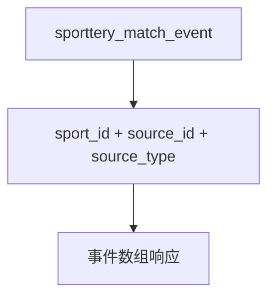

# DC-003 竞彩事件查询数据闭包

## 引用入口

| 资源 ID | 可点击文件 | 用途 |
|---|---|---|
| SRC-MOD | [当前模块需求](../00-module-requirement-pack.md) | 事件弹窗规则 |
| SRC-API-BACKEND | [当前 OpenAPI](../../../../../global/source-materials/api-docs/league-api-definition/league-core-api/data-backend-openapi.json) | 事件查询参数、排序和数组响应 |
| SRC-CODE-EVENT | [事件实体](../../../../../../../apps/league-platform/coredb-entity/src/main/java/com/league/coredb/entity/SportteryMatchEventEntity.java) | 字段和主键 |
| SRC-CODE-EVENT-REPO | [事件 Repository](../../../../../../../apps/league-platform/coredb-repo/src/main/java/com/league/coredb/repository/SportteryMatchEventRepository.java) | 过滤和排序的本地实现观察 |
| SRC-DB13 | [数据库设计](../../../../../global/source-materials/database-docs/第十三轮冲刺竞彩抓取数据库设计和变更.md) | 事件表 |
| SRC-DB-SCHEMA | [最新 DDL](../../../../../global/source-materials/database-docs/北单运营系统-test2_newgoal-202610261418.sql) | 键和索引 |

## 定位

- 状态：ready
- 本卡保存：竞彩事件查询的最小业务路径。
- 本卡不保存：事件任务和前端弹窗步骤。

## 关联范围

- 关联 RSU：RSU-012
- 关联问题：模块 Q-003、Q-004
- 关联功能上下文：无

## 闭包目标

支持按运动项目和官方比赛 ID 查询竞彩事件表记录、字段映射和稳定倒序；不分页，返回全部匹配事件。不使用旧比赛监控的开售前/开售后事件时间条件。

## 输入与输出

| 方向 | 逻辑对象 | 物理载体/字段 | 约束 | 依据 |
|---|---|---|---|---|
| 输入 | 竞彩事件 | sporttery_match_event.sport_id/source_id/source_type/event_id/create_time/event_name/reason_desc | source_id 为官方 matchId；DDL 注释 source_type 固定为 SPORTTERY，本地旧 Repository 也按此过滤 | SRC-DB-SCHEMA、SRC-CODE-EVENT-REPO、Q-004 |
| 输出 | 事件项 | eventId/eventTime/title/exceptionDetail | 分别取 event_id/create_time/event_name/reason_desc；非空事件 ID 必返，集合无记录返回 `[]`，字段缺值保留 `null`，已存储的空字符串原样返回；按 create_time DESC、event_id DESC | SRC-API-BACKEND、SRC-DB-SCHEMA、模块 Q-003、Q-004；API-003 Q-002、Q-003 |

## 关系图

## 表角色

| Table ID | 物理表 | 职责 | 访问模式 | 主键/自然键 | 关键字段 | 数据所有权 |
|---|---|---|---|---|---|---|
| T-001 | sporttery_match_event | 事件查询目标 | 只读 | event_id | sport_id、source_id、source_type、create_time、event_name、reason_desc | 竞彩事件处理 |

## 连接与过滤契约

| Edge ID | From | To | Join Predicate | 基数 | 附加过滤 | 依据 |
|---|---|---|---|---|---|---|
| E-001 | T-001 | 事件数组 | event.sport_id=request.sportId AND event.source_id=request.matchId | 0..N | create_time DESC、event_id DESC；DDL 约定竞彩来源为 SPORTTERY，本地旧 Repository 还按 source_type 过滤 | SRC-API-BACKEND、SRC-DB-SCHEMA、SRC-CODE-EVENT-REPO |

## 数据状态与准备契约

| Profile ID | 数据状态目标 | 准备策略 | 预期推导 | 清理策略 |
|---|---|---|---|---|
| DP-001 | 不同 sport/source_id 的事件及同时间不同 ID 的事件；event_name 可与 reason_title 不同 | 准备具有唯一标识的竞彩事件，按 DDL 填写必填字段 | 只返回对应比赛的事件，按创建时间与 ID 倒序；标题来自 event_name，不从 reason_title 推导 | 按本次创建的 event_id 精确删除 |

## 查询与断言契约

| 用途 | 查询入口 | 断言口径 | 空结果含义 | 依据 |
|---|---|---|---|---|
| 参数及范围 | GET /sporttery/match-monitor/events | sportId 区分足球/篮球，matchId 对应事件 source_id；本地旧实现校验 matchId 为正数 | 无匹配事件时 `data=[]` 且成功 | SRC-API-BACKEND、SRC-CODE-EVENT-REPO、模块 Q-003 |
| 字段与排序 | sporttery_match_event | eventTime/title/exceptionDetail 分别来自 create_time/event_name/reason_desc；非空 event_id 必返；按 create_time、event_id 倒序 | 集合元素字段缺值按模块 Q-003 保留 `null`；合法存储的空字符串原样返回；实际构造需遵守 DDL 非空约束 | SRC-API-BACKEND、SRC-DB-SCHEMA、模块 Q-003、Q-004；API-003 Q-002、Q-003 |

## 清理与隔离

事件使用本次创建的唯一 event_id，按事件 ID 精确删除；任何共享记录若被修改，须先保存并恢复原值。

## 实现状态

用户最新确认标题取 event_name，替代先前的 reason_title 口径；当前本地 Service 不分页，但标题仍取 reason_title，与确认口径不一致，实际接口返回尚未验证。具体数据准备与环境约束由后续自动化设计核对。

## 当前缺口

- 无
