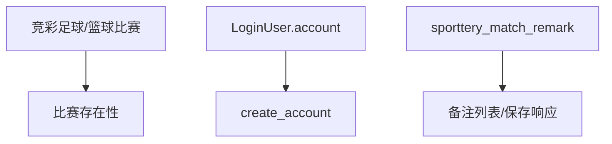

# DC-004 竞彩备注读写数据闭包

## 引用入口

| 资源 ID | 可点击文件 | 用途 |
|---|---|---|
| SRC-MOD | [当前模块需求](../00-module-requirement-pack.md) | 备注展示、编辑、保存和取消 |
| SRC-API-BACKEND | [当前 OpenAPI](../../../../../global/source-materials/api-docs/league-api-definition/league-core-api/data-backend-openapi.json) | 备注查询/保存参数 |
| SRC-CODE-MONITOR | [当前监控服务](../../../../../../../apps/league-platform/data-backend/src/main/java/com/league/backend/service/sporttery/SportteryMatchMonitorService.java) | 登录、长度、upsert和存在性校验 |
| SRC-CODE-REMARK | [备注实体](../../../../../../../apps/league-platform/coredb-entity/src/main/java/com/league/coredb/entity/SportteryMatchRemarkEntity.java) | 唯一键和字段 |
| SRC-CODE-REMARK-REPO | [备注 Repository](../../../../../../../apps/league-platform/coredb-repo/src/main/java/com/league/coredb/repository/SportteryMatchRemarkRepository.java) | 查询和当前用户定位 |
| SRC-DB13 | [数据库设计](../../../../../global/source-materials/database-docs/第十三轮冲刺竞彩抓取数据库设计和变更.md) | 备注表 |
| SRC-DB-SCHEMA | [最新 DDL](../../../../../global/source-materials/database-docs/北单运营系统-test2_newgoal-202610261418.sql) | 唯一键和索引 |

## 定位

- 状态：test-point-ready
- 本卡保存：备注查询与保存最小读写路径。
- 本卡不保存：账号密码、具体环境样本和前端取消步骤。开发环境和账号已确认，密码只从本机安全配置读取。

## 关联范围

- 关联 RSU：RSU-013～RSU-016
- 关联问题：Q-002
- 接口确认：[API-005 Q-001](../../interfaces/API-005-save-match-remark/clarification-questions.md)，用户感知字符计数包含首尾空格。
- 关联功能上下文：FC-003

## 闭包目标

支持多用户备注排序、当前用户标识、空备注、输入标准化、300字符边界、唯一用户记录更新和错误场景。

## 输入与输出

| 方向 | 逻辑对象 | 物理载体/字段 | 约束 | 依据 |
|---|---|---|---|---|
| 输入 | 备注查询 | sport_id/match_id/remark_type=1 + 当前账号 | match_id为竞彩官方ID，sport_id隔离 | SRC-CODE-MONITOR、SRC-CODE-REMARK-REPO |
| 输入 | 备注保存 | request.sportId/matchId/remark | 按用户感知字符计数最多300，首尾空格计入；OpenAPI 描述去首尾空白后非空；账号服务端注入 | API-005 Q-001、SRC-API-BACKEND、SRC-CODE-MONITOR |
| 目标 | sporttery_match_remark | remark_id/sport_id/remark_type/match_id/remark/create_account/update_account | unique(sport_id,remark_type,match_id,create_account) | SRC-CODE-REMARK、SRC-DB-SCHEMA |
| 输出 | 备注项 | account/remark/isCurrentUser/createTime/updateTime | 集合无记录返回 `[]`；备注项具体字段缺值保留 `null`；当前账号首位，其余按更新时间和ID升序 | SRC-API-BACKEND、SRC-CODE-MONITOR、Q-003 |

## 关系图

## 表角色

| Table ID | 物理表 | 职责 | 访问模式 | 主键/自然键 | 关键字段 | 数据所有权 |
|---|---|---|---|---|---|---|
| T-001 | sporttery_match_remark | 备注目标 | 查询/新增/更新 | remark_id；唯一sport/type/match/account | remark、账号、时间 | 用户备注 |
| T-002 | sporttery_football_match / sporttery_basketball_match | 比赛存在性 | 只读校验 | match_id | sport domain | 竞彩采集 |
| T-003 | LoginUser | 当前用户 | 只读上下文 | account | 登录账号 | 认证服务 |

## 连接与过滤契约

| Edge ID | From | To | Join Predicate | 基数 | 附加过滤 | 依据 |
|---|---|---|---|---|---|---|
| E-001 | T-002 | T-001 | remark.sport_id=request.sportId AND remark.match_id=request.matchId AND remark_type=1 | 0..N | sport_id和官方match_id必须匹配 | SRC-CODE-MONITOR |
| E-002 | T-003 | T-001 | remark.create_account=currentAccount | 0..1 | save只更新自己的唯一记录 | SRC-CODE-REMARK、SRC-CODE-REMARK-REPO |

## 数据状态与准备契约

| Profile ID | 数据状态目标 | 准备策略 | 预期推导 | 清理策略 |
|---|---|---|---|---|
| DP-001 | 无备注/当前用户一条/其他用户多条 | 同官方match_id写不同账号的type=1备注 | 当前用户首位，其余按时间和ID升序 | 删除测试账号备注 |
| DP-002 | 当前用户新保存 | 无当前账号记录，调用POST | 新增一条，服务端账号/type正确 | 按唯一账号删除 |
| DP-003 | 重复保存/空白/301字符 | 已有记录和边界输入 | 已有记录更新不新增，非法输入不落库 | 恢复/删除测试记录 |

## 查询与断言契约

| 用途 | 查询入口 | 断言口径 | 空结果含义 | 依据 |
|---|---|---|---|---|
| 备注列表 | GET /sporttery/match-monitor/remarks | 当前用户置顶、其余按updateTime/remarkId升序、isCurrentUser正确 | 无备注data=[]，未登录/非法参数code=2 | SRC-CODE-MONITOR |
| 保存备注 | POST /sporttery/match-monitor/remark | 用户感知字符计数包含首尾空格且不超过300；同用户唯一更新；OpenAPI 描述去空白后非空，源码返回规范化值 | 非法输入不写入；不存在/运动不匹配code=2 | API-005 Q-001、SRC-API-BACKEND、SRC-CODE-MONITOR、SRC-CODE-REMARK |

## 清理与隔离

测试账号使用专用前缀；按sport_id、match_id、remark_type、create_account精确删除，不能只按match_id清理其他用户备注。共享记录保存原值并恢复。

## 当前缺口

用户感知字符计数与源码 strip 后 String.length 的实现有差异，需后续验证；Q-001 未单独裁定保存值是否保留空格。开发环境和登录账号已确认；可用竞彩官方比赛样本及备注造数/清理入口在用例就绪阶段从开发库确认，关联 Q-002。密码不得写入文档或脚本。
