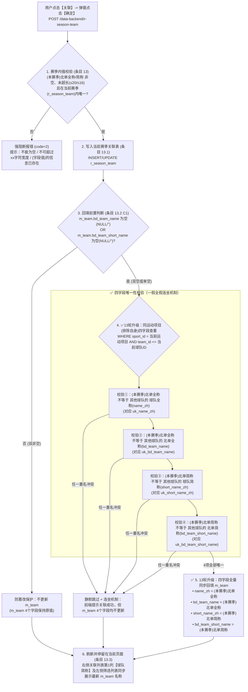

# MOD-11-01-09 关联球队 · 本次迭代深度分析报告（PBL-637）

> **分析对象**：`modules/MOD-11-基础信息管理/MOD-11-01-赛事管理/MOD-11-01-09-关联球队/00-module-requirement-pack.md`
> **本轮迭代核心范围**：严格依据《必读-需求包标记符号说明.md》，聚焦需求包中 **`✅PBL-637，关联球队后名称回填规则优化✅`**（即业务规则条目 **13.2**）在第 13 轮冲刺中的变更内容。
> **信息源**：
> - 模块需求包（`00-module-requirement-pack.md`，PRD 第十一节 1.（9）关联球队 L5017-L5094 切片）
> - **用户补充页面实景与数据库约束截图**（图一：关联球队页面交互布局；图二：`m_team` 表 4 项 `UNIQUE KEY` 物理约束）
> - **第 10 轮历史基线资产**：
>   - 《赛事运营系统第十轮冲刺测试方案.md》——「关联球队逻辑优化（STORY #466）」（L45-L64，10 项核心测试点）
>   - `global/source-materials/test-cases/functional-test-cases/测试用例-基础信息管理.xlsx`——「赛事管理-关联球队」Sheet（14 条存量功能测试用例及执行结果记录）
> - 研发需求清单：`赛事运营系统第十三轮冲刺-PBL研发需求.csv`（PBL-637 验收标准）
> - 接口契约：`data-backend-openapi.json`（`POST /r-season-team`、`GET /r-season-team`）
> - `test2_newgoal` 实库核验（2026-10-27 实测：`m_team`、`r_season_team`、`audit_m_team`、`toto_operation_record`）
>
> 本报告深度融合了**页面实景、数据库唯一索引约束初衷、第 10 轮测试方案/用例沉淀与第 13 轮增量变更对比**，为后续测试点与测试用例编写提供完整依据。

---

## 一、模块定位、页面实景与需求演进背景

### 1.1 关联球队页面实景与字段映射关系（图一解析）

在【基础信息管理 -> 赛事管理 -> 关联球队】页面中，整体采用**“左筛选池 + 中间穿梭键（`>` / `<`）+ 右关联列表 + 行内弹窗修改 + 底部确认关联”**的交互布局：


**页面核心区域与底层表字段映射**：

| 页面区域 | 列名 / 控件 | 对应底层表与字段口径 | 关联回填（PBL-637）后的联动影响 |
| :--- | :--- | :--- | :--- |
| **顶部信息栏** | `运动项目`、`赛事简称`、`赛事全称`、`赛季年` | `m_competition` + `m_season` | 决定本次关联及 `m_team` 查重所在的 `sport_id` 与 `manual_season_id` |
| **左侧：筛选球队列表** | `球队简称`<br>`球队全称`<br>`英文全称` | • `m_team.short_name_zh`<br>• `m_team.name_zh`<br>• `m_team.name_en` | ✅ **13轮新增影响**：当右侧关联触发 4 字段回填后，左侧搜索结果中的 `球队简称` 与 `球队全称` 同步变为回填后的新名称 |
| **中间：穿梭操作** | `>`（加入关联列表）<br>`<`（移出未保存球队） | 前端列表态操作（已入库关联的球队复选框置灰不可移除） | 新移入的球队置于右侧列表上部（条目 10） |
| **右侧：关联球队列表** | 第 1 列：`球队简称` | **固定取数据中心 `m_team.short_name_zh`**（条目 2.1） | ✅ **13轮新增影响**：第 10 轮只回填 `bd_team_short_name`，刷新后第 1 列不变；**第 13 轮同步回填 `short_name_zh`，刷新后第 1 列实时变为新简称，并按新简称重排顺序（条目 2.3）** |
| | 第 2 列：`（本赛季）北单简称`<br>第 3 列：`（本赛季）北单全称`<br>第 4 列：`命名类型` | • 已关联球队：取 `r_season_team` 中的赛季别名<br>• 新加入球队：默认带出 `m_team.bd_team_short_name` / `bd_team_name`（缺失时严格显空） | 点击右侧【修改】按钮（条目 11）在弹窗内填补或修改，点击弹窗【确定】仅更新前端表格行显示，暂不入库；点击底部【关联】确认后写入 `r_season_team` 并触发 `m_team` 回填判定 |

---

### 1.2 需求变更的两大核心初衷（业务一致性 + 图二数据库唯一约束）

为什么第 13 轮冲刺要将条目 13.2 从旧版描述改为新版描述？背后由**业务诉求**与**物理数据库唯一约束**共同决定：

#### 初衷一：消除数据中心球队全/简称与北单全/简称的割裂（业务诉求）
- 当数据源（纳米/贝泰）采集的新球队由预处理服务（`data-computation`）自动入库 `m_team` 时，`bd_team_name` 和 `bd_team_short_name` 为 `NULL`，而 `name_zh`（球队全称）和 `short_name_zh`（球队简称）直接使用了采集源的原始名称（如英文名 `'Yongin City FC'`，或因同名被自动加后缀如实库 `team_id=7123` 的 `'菲律宾(1)'`）。
- 第 10 轮优化时，关联球队仅回填了 `bd_team_name` 和 `bd_team_short_name`，没有更新 `name_zh` 和 `short_name_zh`。这导致运营人员在关联 `team_id=7123` 并填入 `'菲律宾亚运男足'` 后，该球队在库中变成了 `name_zh='菲律宾(1)'`、`bd_team_name='菲律宾亚运男足'`（右侧关联列表第 1 列「球队简称」依然显示 `'菲律宾(1)'`，与第 2 列「（本赛季）北单简称」的 `'菲律宾亚运男足'` 严重不一致）。
- 因此，**PBL-637 的核心业务诉求**是：在回填北单全称、北单简称的同时，**一并用（本赛季）北单全称更新 `球队全称(name_zh)`，用（本赛季）北单简称更新 `球队简称(short_name_zh)`**，使 4 个名称字段保持一致。

#### 初衷二：`m_team` 表底层 4 项 `UNIQUE KEY` 物理约束倒逼查重升级（图二解析）


如上图二数据库表结构所示，`m_team` 表（字符集 `utf8mb4`，排序规则 `utf8mb4_bin`）在物理层定义了 **4 个联合唯一索引（`UNIQUE KEY`）**：
1. `uk_bd_team_name`：`(`**`bd_team_name`**, `sport_id)` —— 约束同运动项目下**北单全称**唯一；
2. `uk_bd_team_short_name`：`(`**`bd_team_short_name`**, `sport_id)` —— 约束同运动项目下**北单简称**唯一；
3. `uk_name_zh`：`(`**`name_zh`**, `sport_id)` —— 约束同运动项目下**球队全称**唯一；
4. `uk_short_name_zh`：`(`**`short_name_zh`**, `sport_id)` —— 约束同运动项目下**球队简称**唯一。

**底层逻辑闭环**：
- 在第 10 轮旧规中，因为只 UPDATE `bd_team_name` 和 `bd_team_short_name` 两列，所以代码只需前置校验待回填值不违反 `uk_bd_team_name` 和 `uk_bd_team_short_name` 即可。
- **而在第 13 轮中，因为 UPDATE 语句要同时更新 `name_zh`、`bd_team_name`、`short_name_zh`、`bd_team_short_name` 四列**，如果前置查重不把 `uk_name_zh`（球队全称）和 `uk_short_name_zh`（球队简称）纳进来：
  - 一旦同运动项目下另一支球队 `T_other` 的 `bd_team_name` 为 `NULL`（或为别的名字），但其 **`name_zh`（球队全称）** 恰好等于当前球队准备回填的 `（本赛季）北单全称`，执行 `UPDATE m_team SET name_zh = ...` 时就会直接触发 MySQL **`1062 Duplicate entry for key 'm_team.uk_name_zh'`** 唯一约束报错！
- 因此，前置唯一性校验**必须从 2 个字段扩展为 4 个字段**：
  - `（本赛季）北单全称` 必须在同 `sport_id`（不含当前球队）的 **`球队全称(name_zh)`** 和 **`北单全称(bd_team_name)`** 中均唯一；
  - `（本赛季）北单简称` 必须在同 `sport_id`（不含当前球队）的 **`球队简称(short_name_zh)`** 和 **`北单简称(bd_team_short_name)`** 中均唯一。

---

## 二、新旧需求精确对比与第 10 轮既有机制继承

### 2.1 条目 13.2 新旧需求逐字 Diff 对照

- **旧需求描述（第 10 轮 ~ 第 12 轮）**：
  > 若数据中心球队的北单全称或北单简称为空，且（本赛季）北单全称、（本赛季）北单简称在当前运动项目下（不含当前球队）均唯一，则用（本赛季）北单全称、（本赛季）北单简称进行更新；

- **本次新需求描述（第 13 轮 `✅` PBL-637）**：
  > ✅若数据中心球队的**北单全称**或**北单简称**为空，且（本赛季）北单全称在当前运动项目下（不含当前球队）的**球队全称、北单全称**均唯一，（本赛季）北单简称在当前运动项目下（不含当前球队）的**球队简称、北单简称**均唯一，则**用（本赛季）北单全称更新球队全称和北单全称，用（本赛季）北单简称更新球队简称和北单简称**；✅

**逐项差异拆解表**：

| 对比维度 | 旧需求（第 10 轮 STORY #466） | 新需求（第 13 轮 ✅ PBL-637） | 是否变更 |
| :--- | :--- | :--- | :---: |
| **1. 回填触发条件** | `m_team.bd_team_name` 为空 **或** `m_team.bd_team_short_name` 为空（含 `NULL` 和 `""`） | `m_team.bd_team_name` 为空 **或** `m_team.bd_team_short_name` 为空（含 `NULL` 和 `""`） | 保持不变 |
| **2. 查重范围与排除规则** | 当前运动项目（`sport_id`）下，且**不含当前球队**（`team_id <> 当前球队`） | 当前运动项目（`sport_id`）下，且**不含当前球队**（`team_id <> 当前球队`） | 保持不变（但业务触发频次剧增，见 3.2） |
| **3. 全称查重目标列** | 仅校验 1 列：`m_team.bd_team_name`（对应 `uk_bd_team_name`） | ✅ **校验 2 列**：**`m_team.name_zh`（球队全称）** + **`m_team.bd_team_name`（北单全称）**（对应 `uk_name_zh` + `uk_bd_team_name`） | **★ 核心变更 1** |
| **4. 简称查重目标列** | 仅校验 1 列：`m_team.bd_team_short_name`（对应 `uk_bd_team_short_name`） | ✅ **校验 2 列**：**`m_team.short_name_zh`（球队简称）** + **`m_team.bd_team_short_name`（北单简称）**（对应 `uk_short_name_zh` + `uk_bd_team_short_name`） | **★ 核心变更 2** |
| **5. 回填更新目标列** | 仅更新 2 列：<br>• `bd_team_name = (本赛季)北单全称`<br>• `bd_team_short_name = (本赛季)北单简称` | ✅ **更新 4 列**：<br>• **`name_zh = (本赛季)北单全称`**<br>• **`bd_team_name = (本赛季)北单全称`**<br>• **`short_name_zh = (本赛季)北单简称`**<br>• **`bd_team_short_name = (本赛季)北单简称`** | **★ 核心变更 3** |
| **6. 重名冲突处理策略** | **静默跳过 + 连坐机制（一假全假）**：当前赛季内唯一但运动项目下重名时，`r_season_team` 正常关联成功，不弹窗报错，底层 `m_team` 整体不更新 | 继承**静默跳过 + 连坐机制（一假全假）**：4 项唯一性校验中任一不满足，`r_season_team` 正常关联成功，底层 `m_team` 的 4 个字段全部静默跳过不更新 | 触发条件扩充为 4 列重名连坐 |

---

### 2.2 第 10 轮测试方案与用例已验证确立的基线机制（直接继承，无需重复存疑）

通过查阅《赛事运营系统第十轮冲刺测试方案.md》（L45-L64）及《测试用例-基础信息管理.xlsx》（`赛事管理-关联球队` Sheet 第 1~14 条用例），以下 **6 项底层业务与技术规则** 已在第 10 轮明确并验证通过：

1. **【全局重名时的“静默跳过”机制】**（10轮方案测试点 4 / 用例 #8）：
   - 当待关联球队存在空值，填补的 `（本赛季）北单全称/简称` 在**当前赛季内唯一**，但在**当前运动项目下与其他球队重名**时：点击【关联】并【确认】，**系统不报错、不阻断，页面正常提示关联成功，`r_season_team` 成功落库；但底层 `m_team` 表静默跳过，不执行回填更新**。
2. **【一假全假的“连坐跳过”机制】**（10轮方案测试点 4 / 用例 #9）：
   - 当填补的 `（本赛季）北单全称` 与 `（本赛季）北单简称` 中，**有一项在当前运动项目下唯一，另一项与其他球队重名**（例如：全称是全新名字，但简称已被其他球队占用；或者反之），触发“连坐机制”，**底层 `m_team` 的全称和简称均不更新**（保持底表原子性与纯净性）。
3. **【排除自身 ID 的逻辑查重】**（10轮方案测试点 5 / 用例 #7）：
   - 唯一性校验 SQL 必须包含 `team_id <> 当前球队ID`，确保不会因为填补的名称与当前球队自身已有的字段值相同而误判为重名。
4. **【双非空时的底表防篡改】**（10轮方案测试点 7 / 用例 #12）：
   - 若球队在 `m_team` 中 `bd_team_name` 和 `bd_team_short_name` **原本均有值**，用户在关联球队列表修改其本赛季名称并确认关联，系统**仅保存在 `r_season_team` 当前赛季映射表中，绝对不触发底层 `m_team` 的 UPDATE 操作**。
5. **【`NULL` 与空字符串 `""` 等效识别】**（10轮方案测试点 8 / 用例 #3）：
   - 底层 `m_team` 的 `bd_team_name` 或 `bd_team_short_name` 无论是 `NULL` 还是空字符串 `""`，均识别为“空”，前端列表对应列显空，且均能触发回填判定逻辑。
6. **【首尾空格 Trim、大小写敏感（`utf8mb4_bin`）与并发 1062 降级】**（10轮方案测试点 9、10 / 用例 #13、#14）：
   - 前端输入自动去除首尾空格；后端基于 `utf8mb4_bin` 严格区分英文字母大小写（如 `acmilan` 与 `ACMilan` 视为不同名称，允许回填）；高并发下若底层触发数据库 1062 唯一键异常，能够捕获处理而不崩溃。

> **⚠️ 第 10 轮历史用例中的关键发现（用例 #11 失败记录）**：
> 在《测试用例-基础信息管理.xlsx》的 `赛事管理-关联球队` Sheet 第 14 行（序号 11）：
> - **用例标题**：`【数据更新】 单项为空触发的全量覆盖校验`
> - **前置条件**：`1. 球队J在 m_team 中全称为“阿森纳”，简称空`（即 `bd_team_name` 有值、`bd_team_short_name` 为 NULL）
> - **执行步骤**：`1. 填补简称“兵工厂”，同时将全称改写为“伦敦兵工厂”；2. 点击关联成功`
> - **预期结果**：`1. 查库验证：m_team 表中全称和简称均被覆盖更新为新值`
> - **第 10 轮测试结果**：标记为 **`失败`**！
> - **深度分析**：这表明在第 10 轮测试中，当 `m_team` 处于“单项为空（一空一有）”状态时，测试预期是“一空触发、全量覆盖”，但当时代码实现可能只更新了为空的字段（或存在缺陷）。在第 13 轮扩展为 4 字段更新时，这一场景是极高价值的回归与确认点（详见第五节问题 1）。

---

## 三、第 13 轮冲刺（`✅` PBL-637）核心测试场景深度拆解

围绕本次 `✅` 变更的三个核心点（**4列查重、4列回填、排除自身与UI回显联动**），本轮新增及升级的核心机制拆解如下：



### 3.1 重点剖析 A：为什么“排除当前球队自身（`team_id <> 当前球队`）”在第 13 轮变得尤为关键？

- **第 10 轮时**：只查 `bd_team_name` 和 `bd_team_short_name`。对于一支双空球队（`bd_team_name = NULL, bd_team_short_name = NULL`），只有当它是“单空”且未修改已有那一项时，才会触发“排除自身”逻辑。
- **第 13 轮时（重大变化）**：
  - 在 `m_team` 表中，`name_zh`（球队全称）和 `short_name_zh`（球队简称）是 `NOT NULL` 必填列，**每一支双空球队在 `m_team` 中都必然已经有一组非空的 `name_zh` 和 `short_name_zh`**（例如实库 `team_id=4848` 的 `name_zh='东部第七'`, `short_name_zh='东部第七'`, `bd_team_name=NULL`, `bd_team_short_name=NULL`）。
  - 运营人员在关联该球队时，极高频的操作是：**直接把该球队原有的全称/简称（或其中之一）作为它的 `（本赛季）北单全称` / `（本赛季）北单简称` 填入**（例如给 `team_id=4848` 填入北单全称 `'东部第七'`、北单简称 `'东部第七'`；或者给原名 `'阿森纳'` 的双空球队填入北单全称 `'阿森纳'`、北单简称 `'枪手'`）。
  - 此时，后端去查 `m_team.name_zh` 和 `m_team.short_name_zh` 是否唯一时，**如果 SQL 漏写了 `AND team_id <> :curTeamId`（或者在内存中查重未过滤自身）**，就会把当前球队自己的 `name_zh` / `short_name_zh` 当作重名冲突，触发静默跳过，导致 `bd_team_name` 和 `bd_team_short_name` 永远回填不进去！
  - **测试必测点**：
    1. 双空球队填补的 `（本赛季）北单全称`、`（本赛季）北单简称` **与自身原 `name_zh`、`short_name_zh` 完全相同**（与其他球队不重名）→ 必须排除自身，成功回填 `bd_team_name` 和 `bd_team_short_name`；
    2. 双空球队填补的 `（本赛季）北单全称` **与自身原 `name_zh` 相同**，但 `（本赛季）北单简称` **修改为新简称**（或反之：简称与自身原 `short_name_zh` 相同，全称修改为新全称）→ 必须排除自身，4 个字段全部成功更新为新全称和新简称！

### 3.2 重点剖析 B：四维度跨列重名冲突与“连坐静默跳过”矩阵

在第 13 轮中，同运动项目下其他球队（`team_id <> 当前球队` 且 `sport_id = 当前运动项目`）对回填的阻断扩展为 **4 个独立维度**，且任一维度冲突均触发“静默跳过 + 连坐不更新”：

| 冲突维度 | 构造场景（同 `sport_id` 下存在另一支球队 `T_other`） | 当前空值球队 `T_cur` 填补的本赛季北单名 | 赛季关联结果 (`r_season_team`) | 主表回填结果 (`m_team` 4个字段) | 对应保护的物理唯一索引 |
| :--- | :--- | :--- | :--- | :--- | :--- |
| **维度 1：与他队 `球队全称(name_zh)` 重名**（★13轮新增） | `T_other` 的 `name_zh = '菲律宾(1)'`，`bd_team_name = '菲律宾亚运男足'`（或 `NULL`） | 北单全称填 `'菲律宾(1)'`（与 `T_other.name_zh` 重名），北单简称填全新唯一名 `'菲男足测试'` | ✅ 关联成功 | ❌ **静默跳过（连坐）**：4 个字段均不更新（原 `name_zh`/`short_name_zh` 不变，`bd_*` 仍为空） | `uk_name_zh (name_zh, sport_id)` |
| **维度 2：与他队 `北单全称(bd_team_name)` 重名** | `T_other` 的 `name_zh = '菲律宾(1)'`，`bd_team_name = '菲律宾亚运男足'` | 北单全称填 `'菲律宾亚运男足'`（与 `T_other.bd_team_name` 重名），北单简称填全新唯一名 `'菲男足测试'` | ✅ 关联成功 | ❌ **静默跳过（连坐）**：4 个字段均不更新 | `uk_bd_team_name (bd_team_name, sport_id)` |
| **维度 3：与他队 `球队简称(short_name_zh)` 重名**（★13轮新增） | `T_other` 的 `short_name_zh = '库德梅/梅尔滕斯'`，`bd_team_short_name = '库德梅托娃/梅尔'`（或 `NULL`） | 北单全称填全新唯一名，北单简称填 `'库德梅/梅尔滕斯'`（与 `T_other.short_name_zh` 重名） | ✅ 关联成功 | ❌ **静默跳过（连坐）**：4 个字段均不更新 | `uk_short_name_zh (short_name_zh, sport_id)` |
| **维度 4：与他队 `北单简称(bd_team_short_name)` 重名** | `T_other` 的 `short_name_zh = '库德梅/梅尔滕斯'`，`bd_team_short_name = '库德梅托娃/梅尔'` | 北单全称填全新唯一名，北单简称填 `'库德梅托娃/梅尔'`（与 `T_other.bd_team_short_name` 重名） | ✅ 关联成功 | ❌ **静默跳过（连坐）**：4 个字段均不更新 | `uk_bd_team_short_name (bd_team_short_name, sport_id)` |
| **反向维度：跨 `sport_id` 同名放行** | 足球（`sport_id=1`）已存在 `name_zh=bd_team_name='巴塞罗那'`、`short_name_zh=bd_team_short_name='巴萨'` | 在**篮球（`sport_id=2`）**赛季下，将双空球队填为北单全称 `'巴塞罗那'`、北单简称 `'巴萨'` | ✅ 关联成功 | ✅ **正常回填**：因 `sport_id` 不同，4 个唯一索引均按 `(字段, sport_id)` 联合唯一，4 个字段全部成功更新 | 联合索引中的 `sport_id` 隔离列 |

### 3.3 重点剖析 C：四字段更新后的页面刷新回显闭环（结合图一）

当双空/单空球队填补了全新的 `（本赛季）北单全称`（如 `'龙仁市FC'`）和 `（本赛季）北单简称`（如 `'龙仁市'`），且通过 4 字段唯一性校验完成回填后：
1. **底层 `m_team` 变化**：
   - `name_zh`：由 `'Yongin City FC'` 变为 `'龙仁市FC'`；
   - `bd_team_name`：由 `NULL` 变为 `'龙仁市FC'`；
   - `short_name_zh`：由 `'Yongin City FC'` 变为 `'龙仁市'`；
   - `bd_team_short_name`：由 `NULL` 变为 `'龙仁市'`。
2. **页面刷新停留当前页（条目 13.3）后的 UI 变化（图一左右两侧列表联动）**：
   - **右侧「关联球队列表」**：第 1 列 `球队简称`（绑定 `m_team.short_name_zh`）由原来的 `'Yongin City FC'` **实时刷新为 `'龙仁市'`**，与第 2 列 `（本赛季）北单简称` 保持一致，并根据新的 `球队简称` 重新排序；
   - **左侧「筛选球队列表」**：在搜索框输入 `'龙仁市'` 查询，列表中该球队的 `球队简称` 显示 `'龙仁市'`、`球队全称` 显示 `'龙仁市FC'`；
   - **球队管理模块联动**：前往【基础信息管理 -> 球队管理】列表查看该球队，其球队全称、球队简称、北单全称、北单简称 4 列均已同步展示为最新回填值。

---

## 四、实库数据支撑与核验 SQL（`test2_newgoal` 2026-10-27）

### 4.1 实库可直接复用的三类高价值样本

1. **样本类 A（`name_zh != bd_team_name` 或 `short_name_zh != bd_team_short_name` 的存量分离样本，最适合测维度 1~4 跨字段冲突）**：
   - `team_id = 7123`（足球 `sport_id=1`）：`name_zh = '菲律宾(1)'`，`short_name_zh = '菲律宾(1)'`，`bd_team_name = '菲律宾亚运男足'`，`bd_team_short_name = '菲律宾亚运男足'`。
     - *妙用*：用另一支足球双空球队关联时，若填 `'菲律宾(1)'` 可精准测试“仅与他队 `name_zh`/`short_name_zh` 重名（不与 `bd_team_name` 重名）”的第 13 轮新增拦截点；若填 `'菲律宾亚运男足'` 则可测试“仅与他队 `bd_team_name`/`bd_team_short_name` 重名”的拦截点！
   - `team_id = 3322`（网球 `sport_id=6`）：`name_zh = '库德梅托娃/梅尔滕斯'`，`short_name_zh = '库德梅/梅尔滕斯'`，`bd_team_name = '库德梅托娃/梅尔滕斯'`，`bd_team_short_name = '库德梅托娃/梅尔'`。
2. **样本类 B（双空待回填样本，共 2,562 支）**：
   - 足球（`sport_id=1`，2,501 支）：`team_id = 4148`（`'Yongin City FC'`）、`team_id = 6295`（`'桑德维肯(1)'`）、`team_id = 6472`（`'奥尔堡(1)'`）、`team_id = 6479`（`'科灵(1)'`）。
   - 篮球（`sport_id=2`，61 支）：`team_id = 4848`（`'东部第七'`）、`team_id = 4849`（`'东部第八'`）。
3. **样本类 C（双非空防篡改样本，共 2,173 支）**：
   - 足球：`team_id = 892`（`'帕福斯'`）、`team_id = 1107`（`'希腊人竞技'`）等。

---

## 五、已确认决策与测试策略基线（用户答复闭环）

结合第 10 轮历史资产与用户的明确答复（2026-10-27 确认），本模块测试点与测试用例设计严格遵循以下基线结论：

1. **单项为空触发时的 4 字段全量覆盖规则（`Q-MOD110109-001`：已确认 A）**：
   - 第 10 轮《测试用例-基础信息管理.xlsx》序号 11 的“失败”系未及时更新文档状态，实际功能已验证通过；
   - 在第 13 轮中，只要数据中心球队（`m_team`）的 `北单全称` **或** `北单简称` 任一为空（含双空、仅全称空、仅简称空），且用户填写的（本赛季）北单全称、北单简称在当前运动项目下（不含自身）4 字段均唯一，确认关联后统一将 `m_team` 的 `球队全称(name_zh)`、`北单全称(bd_team_name)`、`球队简称(short_name_zh)`、`北单简称(bd_team_short_name)` **4 个字段全量覆盖更新为新值**。
2. **双空/单空球队填补名称与自身原 `name_zh` / `short_name_zh` 相同时的排除自身查重（`Q-MOD110109-002`：已确认 A）**：
   - 因第 13 轮将 `name_zh` 和 `short_name_zh` 纳入查重，当双空球队填入的（本赛季）北单全称/简称与该球队自身原有的 `name_zh` / `short_name_zh` 相同（或一项相同、一项改为新名称）时，系统查重必须排除当前球队自身（`team_id <> 自身`），正常完成 4 字段回填更新。
3. **测试点与测试用例组织策略（`Q-MOD110109-003`：已确认 A，在原第 10 轮测试点和测试用例基础上修改、新增）**：
   - 在第 10 轮《赛事运营系统第十轮冲刺测试方案.md》及《测试用例-基础信息管理.xlsx》（`赛事管理-关联球队` Sheet 原 14 条用例）基础上进行修改升级（将原 2 字段查重与回填升级为 4 字段）并新增第 13 轮专属场景（与他队 `name_zh`/`short_name_zh` 重名静默跳过、双空与自身原 `name_zh`/`short_name_zh` 相同排除自身、跨运动项目同名放行、回填后页面左右列表「球队简称/全称」同步刷新回显）。
4. **高并发 1062 唯一键异常捕获校验保留（`Q-MOD110109-004`：已确认 B）**：
   - 保留原第 10 轮序号 14 的并发边界测试点，覆盖多账号同时填入相同名称关联时的异常捕获与提示。

---

## 六、附 · 实库核验与测试辅助 SQL 预案

```sql
-- 1. 查找可用于测试 PBL-637 回填的“北单全称/简称双空”候选球队（足球 sport_id=1 / 篮球 sport_id=2）
SELECT 
    team_id, sport_id, name_zh, short_name_zh, bd_team_name, bd_team_short_name, 
    nami_id_match_status, beitai_id_match_status, create_account
FROM m_team
WHERE (bd_team_name IS NULL OR bd_team_name = '')
  AND (bd_team_short_name IS NULL OR bd_team_short_name = '')
  AND sport_id IN (1, 2)
ORDER BY team_id DESC
LIMIT 20;

-- 2. 查找实库中“球队全称/简称 与 北单全称/简称 不一致”的存量分离样本（用于构造跨字段唯一性冲突测试）
-- 如 team_id = 7123：name_zh='菲律宾(1)', bd_team_name='菲律宾亚运男足'
-- 如 team_id = 3322：short_name_zh='库德梅/梅尔滕斯', bd_team_short_name='库德梅托娃/梅尔'
SELECT 
    team_id, sport_id, name_zh, short_name_zh, bd_team_name, bd_team_short_name
FROM m_team
WHERE bd_team_name IS NOT NULL AND bd_team_name <> ''
  AND (name_zh <> bd_team_name OR short_name_zh <> bd_team_short_name);

-- 3. 模拟条目 13.2 的运动项目下（不含当前球队）四字段唯一性预检 SQL
SELECT 
    team_id, name_zh, short_name_zh, bd_team_name, bd_team_short_name,
    CASE 
        WHEN name_zh = :new_full_name THEN '与既有【球队全称(uk_name_zh)】冲突'
        WHEN bd_team_name = :new_full_name THEN '与既有【北单全称(uk_bd_team_name)】冲突'
        WHEN short_name_zh = :new_short_name THEN '与既有【球队简称(uk_short_name_zh)】冲突'
        WHEN bd_team_short_name = :new_short_name THEN '与既有【北单简称(uk_bd_team_short_name)】冲突'
    END AS conflict_reason
FROM m_team
WHERE sport_id = :cur_sport_id
  AND team_id <> :cur_team_id
  AND (
      name_zh = :new_full_name 
      OR bd_team_name = :new_full_name 
      OR short_name_zh = :new_short_name 
      OR bd_team_short_name = :new_short_name
  );
```
