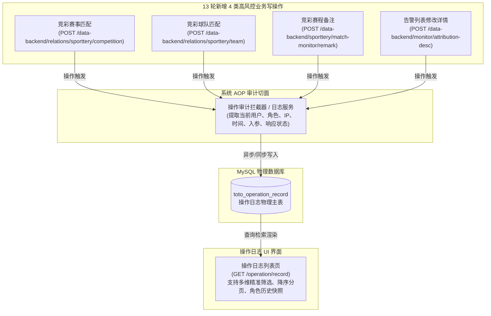

# MOD-13 操作日志 · 本次迭代深度分析报告（PBL-639）

> **分析对象**：`modules/MOD-13-操作日志/00-module-requirement-pack.md`
> **本轮迭代核心范围**：严格限定为需求包中 **`✅PBL-639，13轮操作日志与系统权限扩展✅`** 所覆盖的第 13 轮冲刺新增操作日志埋点（基础信息管理-竞彩赛事匹配、竞彩球队匹配；比赛监控-竞彩赛程备注；异常管理-修改详情）以及操作日志页面的精准检索与展示闭环。
> **信息源**：
> - 模块需求包（`00-module-requirement-pack.md`，PRD 第十三节 L5862-L6254 切片）
> - 《竞猜赛事运营系统需求PRD文档-13轮冲刺.md》第十四节《系统权限（13）》（L6256-L6299）
> - 《必读-测试点编写规范.md》与《必读-需求包标记符号说明.md》
> - `analysis-docs/` 全局追溯矩阵（`竞猜赛事运营系统-表模块接口追溯矩阵.md`）与 ER 图
> - `test2_newgoal` 真实数据库核验（`toto_operation_record`、`toto_permission`、`toto_role`、`toto_account`）
> - **用户答复与决策确认**（2026-10-27 确认：聚焦日志本身、业务失败记入日志、修改详情入口为告警列表操作列、账号精确查询、文字描述断言、不动态删改角色）
>
> 本报告为 **PBL-639 测试点与用例编写的深度基础文档**：全面拆解 13 轮新增日志规则 → 剖析底层接口与数据落库机制 → 明确实库形态与验证路径 → 锁定已确认设计决策。

---

## 一、模块定位与 13 轮迭代背景

### 1.1 模块在系统中的位置与风控审计定位

【操作日志】（对应系统一级菜单“操作日志/审计”，权限标识 `sj:czrz:select`）是竞猜赛事运营系统的**底层审计与风控安全基石**。
它记录全系统所有关键写操作（新增、修改、删除、审核、匹配、备注等）的发生主体、时间、行为类型及执行结果，满足等保合规性要求，同时为赛事异常回溯、人为操作失误定位提供第一手不可篡改的证据链。



### 1.2 13 轮冲刺核心新增变化对照（PBL-639）

13 轮冲刺中，平台全新上线了**竞彩数据采集与监控模块**，并扩展了异常告警的修改能力。伴随业务功能的落地，**操作日志必须同频扩展**，防止出现“有业务无审计”的风控死角。

| 序号 | 13轮新增操作类型（`operation_type`） | 归属模块（`operation_module`） | 触发入口与用户行为 | 对应后端接口契约 | 核心落库实体与状态 |
| :---: | :--- | :--- | :--- | :--- | :--- |
| **1** | ✅ **竞彩赛事匹配** | 基础信息管理 | 竞彩赛事匹配页，勾选待匹配赛事后点击【匹配】并在二次确认弹窗中点击【确定】 | `POST /data-backend/relations/sporttery/competition` | `r_sporttery_basic_data`<br>`relation_status=1` |
| **2** | ✅ **竞彩球队匹配** | 基础信息管理 | 竞彩球队匹配页，勾选待匹配球队后点击【匹配】并在二次确认弹窗中点击【确定】 | `POST /data-backend/relations/sporttery/team` | `r_sporttery_team_data`<br>`source_type=4` |
| **3** | ✅ **竞彩赛程备注** | 比赛监控 | 竞彩赛程监控页，点击赛程【备注】弹出弹窗，编辑当前用户备注后点击【保存】 | `POST /data-backend/sporttery/match-monitor/remark` | `sporttery_match_remark`<br>唯一键更新/插入 |
| **4** | ✅ **修改详情** | 异常管理 | **告警管理列表**，点击行操作栏新增的【修改】按钮，弹出修改详情框，修改异常原因详述（≤300字）后点击【保存】 | `POST /data-backend/monitor/attribution-desc` | `task.attribution_desc`<br>告警原因详述更新 |

---

## 二、本次 13 轮冲刺 `✅` 需求逐条深度拆解

### 2.1 新增日志项 ①：【基础信息管理】 - 【竞彩赛事匹配】

**需求原文（✅）**：
> `| ✅基础信息管理✅ | ✅竞彩赛事匹配✅ | ✅竞彩赛事匹配页的匹配按钮✅ |  |`

**深度剖析与业务链路**：
1. **触发时机与前置条件**：
   - 运营人员登录具有匹配权限的账号，进入“基础信息管理 - 竞彩赛事管理 - 匹配赛事”页面；
   - 勾选至少 1 个候选赛事（支持多选），点击【匹配】按钮；
   - 系统弹出二次确认提示框：“是否确认与以下赛事进行匹配：{赛事简称}、{赛事简称}？”；
   - 用户在提示框中点击【确定】时，前端发送 `POST /data-backend/relations/sporttery/competition` 请求。
2. **入库字段预期（断言核心）**：
   - `operation_module`：`基础信息管理`
   - `operation_type`：`竞彩赛事匹配`
   - `operation_code`：推导口径为 `jcxxgl:jcssgl:match`
   - `result`：
     - 若接口响应 HTTP 200 / 业务成功，记录为 `成功`；
     - 若业务校验拦截（如提示“{赛事简称}已匹配”）导致接口报错，依据**用户确认决策 2**，后端必须记录一条 `result='失败'` 的日志记录，且在 `error_detail` 中保留错误提示；
   - `account_user`：当前登录操作人员真实姓名（如 `张玉迪`）；
   - `account`：当前登录账号（如 `zhangyudi`）；
   - `operation_role_name`：操作人当前生效角色名快照（如 `全权限用户`）；
   - `operation_time`：执行完成的系统时间（精确到秒）。
3. **数据实体联动影响**：
   - 业务数据落入 `r_sporttery_basic_data`（`relation_status=1`）及审计历史 `audit_r_sporttery_basic_data`。

---

### 2.2 新增日志项 ②：【基础信息管理】 - 【竞彩球队匹配】

**需求原文（✅）**：
> `| ✅基础信息管理✅ | ✅竞彩球队匹配✅ | ✅竞彩球队匹配页的匹配按钮✅ |  |`

**深度剖析与业务链路**：
1. **触发时机与前置条件**：
   - 运营人员进入“基础信息管理 - 竞彩球队管理 - 匹配球队”页面；
   - 勾选 1 支待匹配的标准球队（单选），点击【匹配】按钮；
   - 弹出二次确认提示框：“是否确认与以下球队进行匹配：{球队简称}？”；
   - 用户点击【确定】时，发送 `POST /data-backend/relations/sporttery/team` 请求。
2. **入库字段预期（断言核心）**：
   - `operation_module`：`基础信息管理`
   - `operation_type`：`竞彩球队匹配`
   - `operation_code`：推导口径为 `jcxxgl:jcqdgl:match`；
   - `result`：
     - 匹配通过记录 `成功`；
     - 若触发冲突校验（“{当前球队简称}已与其他球队匹配”或“已匹配”）报错，依据**用户确认决策 2**，记录为 `失败` 并记录 `error_detail`；
   - 基础操作人信息（账号、姓名、角色、时间、IP）完整捕获；
3. **数据实体联动影响**：
   - 业务数据落入 `r_sporttery_team_data`（`source_type=4`）及 `audit_r_sporttery_team_data`。

---

### 2.3 新增日志项 ③：【比赛监控】 - 【竞彩赛程备注】

**需求原文（✅）**：
> `| ✅比赛监控✅ | ✅竞彩赛程备注✅ | ✅竞彩赛程监控页备注弹窗的保存按钮✅ |  |`

**深度剖析与业务链路**：
1. **触发时机与前置条件**：
   - 运营人员进入“比赛监控 - 竞彩赛程监控”页面；
   - 点击列表中任一赛程行的【备注】按钮，弹出备注框；
   - 在当前用户备注输入框内编辑内容（≤300字符），点击【保存】按钮；
   - 前端发送 `POST /data-backend/sporttery/match-monitor/remark`。
2. **反向规则（区别于取消）**：
   - 若用户点击【取消】或右上角关闭图标，弹窗直接关闭且不发起保存请求，**绝对不得生成操作日志记录**；
   - 仅当点击【保存】成功触发更新并落库后，才生成日志。
3. **入库字段预期（断言核心）**：
   - `operation_module`：`比赛监控`
   - `operation_type`：`竞彩赛程备注`
   - `operation_code`：推导口径为 `bsjk:jcscjk:remark`；
   - `result`：`成功`；
   - 业务数据落入 `sporttery_match_remark`（唯一键 `sport_id + remark_type + match_id + create_account`）与 `audit_sporttery_match_remark`。

---

### 2.4 新增日志项 ④：【异常管理】 - 【修改详情】

**需求原文（✅）**：
> `| ✅异常管理✅ | ✅修改详情✅ | ✅告警管理页修改详情弹窗的保存按钮✅ |  |`

**用户确认与页面交互实景**：
在告警管理列表（`异常管理 -> 告警管理`）的右侧操作栏中，第 13 轮冲刺**新增了【修改】操作功能按钮**（位于【详情】与【核实】等操作旁）：


**深度剖析与业务链路**：
1. **触发时机与前置条件**：
   - 运营人员进入“异常管理 - 告警管理”列表；
   - 点击列表中目标记录操作列新增的【修改】功能按钮；
   - 弹出“修改详情框”（页面信息同告警详情，但异常详情文本框可编辑）；
   - 在输入框内修改异常原因详述（≤300 字符，支持汉字、英文字母、数字和符号）；
   - 点击【保存】按钮，前端向后端发送 `POST /data-backend/monitor/attribution-desc`。
2. **校验与拦截规则**：
   - 若内容合规，提交成功并关闭弹窗刷新页面，日志记录为 `成功`；
   - 若字符超长（>300 字符）等被后端拦截报错，依据**决策 2**，记录 `result='失败'` 的日志；
   - 若点击【取消】或右上角关闭图标，弹窗关闭且不发起接口调用，**不生成操作日志**；
3. **入库字段预期（断言核心）**：
   - `operation_module`：`异常管理`
   - `operation_type`：`修改详情`（在操作日志列表中统一展示为“修改详情”）
   - `operation_code`：推导口径为 `ycgl:gjgl:update`
   - `result`：`成功`（更新异常任务表 `task.attribution_desc`）。

---

## 三、操作日志列表与查询规则全维度拆解

当 13 轮冲刺产生上述 4 类新型日志后，操作日志页面自身必须能够**准确呈现与精准检索**这些增量数据：

### 3.1 查询条件规则与边界测试矩阵

| 筛选条件 | 控件类型与行为规则 | 13 轮增量验证要点 | 异常与边界断言 |
| :--- | :--- | :--- | :--- |
| **操作模块** | 单选下拉框，包含系统全量业务模块 | 下拉选项须包含 `基础信息管理`、`比赛监控`、`异常管理` | 切换模块后，【操作类型】二级联动下拉必须即时刷新为对应模块下的类型 |
| **操作类型** | 二级联动下拉框 | ① 选择 `基础信息管理` 时，二级选项中须包含 `竞彩赛事匹配` 与 `竞彩球队匹配`；<br>② 选择 `比赛监控` 时，须包含 `竞彩赛程备注`；<br>③ 选择 `异常管理` 时，须包含 `修改详情` | 选项名称必须与数据库 `operation_type` 完全一致，且支持同 V2 系统的风险管理二级选项展示（球队/赛事添加/移除） |
| **操作角色** | 下拉选择框，选项内容为本系统全量角色 | 下拉动态拉取 `toto_role` 中有效角色列表 | 支持按当前角色精确过滤出 13 轮操作记录 |
| **操作账号** | 文本输入框，**严格精确查询**（用户确认：决策 4-A） | 输入操作人登录账号（如 `zhangyudi`） | 必须严格精确匹配（`WHERE account = ?`），输入前缀/子串（如 `zhang`）不得查出结果 |
| **操作时间** | 双日期时间选择器，**精确到秒** | 支持指定起始时间与截止时间精确检索增量日志 | ① 选择跨度闭区间 `[start, end]` 精确包含秒级日志；② 截止时间小于起始时间时给出前端校验提示 |
| **【重置】按钮** | 点击动作 | **红线规则**：点击“重置”将所有筛选条件恢复默认空值，**但绝不自动刷新列表查询结果** | 用户重置后列表依然保持上一次的查询结果，只有手动点击【查询】后才重新检索 |

### 3.2 列表展示与排序规则

1. **展示列与字段映射**：
   - `操作模块` ↔ `operation_module`
   - `操作类型` ↔ `operation_type`
   - `操作结果` ↔ `result`（仅“成功”或“失败”）
   - `操作用户` ↔ `account_user`（用户真实姓名/展示名）
   - `操作时间` ↔ `operation_time`（格式：`YYYY-MM-DD HH:mm:ss`）
   - `操作账号` ↔ `account`（登录账号名）
   - `操作角色` ↔ `operation_role_name`（操作时的角色名称快照）
2. **默认排序**：按 `operation_time DESC` 严格倒序，最新发生的操作展示在第一行。
3. **角色快照机制**：
   - 需求明确规定：**“被删除或被修改过的角色，操作记录也能够展示”**；
   - 底层机制：`toto_operation_record.operation_role_name` 在写日志时已固化存储了当时的角色名称字符串，断言展示时取行内快照字段值。
4. **分页器控制**：支持切换页码、每页条数（如 10/20/50），分页切换时维持当前筛选条件。

### 3.3 结果状态与过滤白名单（反向规则）

需求对“操作结果”与“记录范围”规定了严格的过滤白名单：
1. **合法结果枚举**：仅由 `成功` 与 `失败` 组成。
2. **免记/不记录场景（白名单排除）**：
   - **登录失败不记录**：登录密码错误、账号不存在等失败尝试不得写入操作日志；
   - **双因子绑定失败不记录**：若未输入正确的账号密码导致绑定失败，不产生操作日志。
   - **页面浏览与只读查询不记录**：单纯的页面进入、列表查询、重置等只读操作不记录。
   - **弹窗取消不记录**：点击【取消】、关闭弹窗等放弃行为不记录。

---

## 四、底层数据模型与物理表映射（test2_newgoal 实库核验）

### 4.1 核心日志表 `toto_operation_record` 字段映射

实库物理表结构（共 184,754+ 条历史存量日志）与前端列映射对照：

| 物理字段名 | 数据类型 | 约束 / 注释 | 前端列表列名 | 13轮增量预期写入口径 |
| :--- | :--- | :--- | :--- | :--- |
| `record_id` | `int unsigned` | 主键，自增 | （无） | 自增递增 |
| `operation_module` | `varchar(100)` | 操作模块 | 操作模块 | 枚举：`基础信息管理`、`比赛监控`、`异常管理` |
| `operation_type` | `varchar(100)` | 操作类型 | 操作类型 | 枚举：`竞彩赛事匹配`、`竞彩球队匹配`、`竞彩赛程备注`、`修改详情` |
| `operation_code` | `varchar(50)` | 业务操作唯一标识 | （无） | 接口权限编码（如 `jcxxgl:jcssgl:match`） |
| `result` | `varchar(20)` | 操作结果 | 操作结果 | `成功` 或 `失败` |
| `account_user` | `varchar(200)` | 操作用户（姓名） | 操作用户 | 登录用户真实姓名（来自 `toto_account.account_user`） |
| `account` | `varchar(100)` | 操作账号 | 操作账号 | 登录账号名（来自 `toto_account.account`） |
| `rdc_id` / `rdc_name`| `int` / `varchar(20)`| 中心/分中心标识 | （无） | 当前分中心（如 0 主中心） |
| `operation_time` | `datetime` | 操作时间，带索引 | 操作时间 | 触发提交完成的系统时间（`YYYY-MM-DD HH:mm:ss`） |
| `operation_role_id` | `int` | 操作角色 ID | （无） | 账号关联角色 ID |
| `operation_role_name`| `varchar(20)` | 操作角色名快照 | 操作角色 | 账号关联角色名称（快照持久化，防篡改） |
| `ipaddress` | `varchar(20)` | 客户端 IP | （无） | 请求客户端 IP 地址 |
| `error_detail` | `varchar(2000)`| 错误信息详情 | （无） | 当 `result='失败'` 时记录业务异常/校验提示 |

### 4.2 4 个新增操作在 `toto_operation_record` 的入库形态基线

```sql
-- 样本 1：竞彩赛事匹配成功日志
INSERT INTO `toto_operation_record` 
(`operation_module`, `operation_type`, `operation_code`, `result`, `account_user`, `account`, `rdc_id`, `rdc_name`, `operation_time`, `operation_role_id`, `operation_role_name`, `ipaddress`)
VALUES 
('基础信息管理', '竞彩赛事匹配', 'jcxxgl:jcssgl:match', '成功', '张玉迪', 'zhangyudi', 0, '主中心', '2026-10-27 10:30:00', 11, '全权限用户', '192.168.22.100');

-- 样本 2：竞彩球队匹配成功日志
INSERT INTO `toto_operation_record` 
(`operation_module`, `operation_type`, `operation_code`, `result`, `account_user`, `account`, `rdc_id`, `rdc_name`, `operation_time`, `operation_role_id`, `operation_role_name`, `ipaddress`)
VALUES 
('基础信息管理', '竞彩球队匹配', 'jcxxgl:jcqdgl:match', '成功', '张玉迪', 'zhangyudi', 0, '主中心', '2026-10-27 10:31:00', 11, '全权限用户', '192.168.22.100');

-- 样本 3：竞彩赛程备注成功日志
INSERT INTO `toto_operation_record` 
(`operation_module`, `operation_type`, `operation_code`, `result`, `account_user`, `account`, `rdc_id`, `rdc_name`, `operation_time`, `operation_role_id`, `operation_role_name`, `ipaddress`)
VALUES 
('比赛监控', '竞彩赛程备注', 'bsjk:jcscjk:remark', '成功', '张玉迪', 'zhangyudi', 0, '主中心', '2026-10-27 10:32:00', 11, '全权限用户', '192.168.22.100');

-- 样本 4：告警管理修改详情成功日志
INSERT INTO `toto_operation_record` 
(`operation_module`, `operation_type`, `operation_code`, `result`, `account_user`, `account`, `rdc_id`, `rdc_name`, `operation_time`, `operation_role_id`, `operation_role_name`, `ipaddress`)
VALUES 
('异常管理', '修改详情', 'ycgl:gjgl:update', '成功', '张玉迪', 'zhangyudi', 0, '主中心', '2026-10-27 10:33:00', 11, '全权限用户', '192.168.22.100');
```

---

## 五、已确认决策与测试策略基线（用户答复闭环）

基于用户的明确答复与现场指导，后续测试点与测试用例设计遵循以下 **6 条基线原则**：

1. **测试范围边界（决策 1：选择 A）**：
   - 本模块测试点**严格聚焦操作日志本身**（4 类新增操作日志的触发、落库断言、页面展示与多维检索过滤）；
   - PRD 中关于系统权限扩展的菜单隐藏、按钮隐藏等功能点测试，统一由各对应业务模块（如 MOD-06、MOD-07、MOD-11）独立承接测试。
2. **失败日志记录口径（决策 2：选择 A）**：
   - 业务校验拦截（如球队/赛事匹配冲突报错、修改异常详情超长校验拦截等）属于接口业务失败，后端**必须写入一条 `result='失败'` 的操作日志记录**，并在 `error_detail` 中保留错误信息提示。
3. **“修改详情”入口与展示口径（决策 3：选择 A，并修正交互认知）**：
   - **触发入口**：位于【异常管理 -> 告警管理】列表的操作列中，新增【修改】功能按钮；点击后弹出“修改详情”弹窗页，编辑内容点击【保存】后触发日志记录；
   - **日志展示**：在操作日志列表及查询条件的【操作类型】下拉中，选项名称统一规范展示为 **`修改详情`**（归属模块为 `异常管理`）。
4. **账号查询匹配口径（决策 4：选择 A）**：
   - 操作账号筛选框执行**严格精确匹配**（`WHERE account = ?`），不进行前后模糊包含匹配。
5. **权限配置断言策略（决策 5：依据文字描述断言）**：
   - 因实库尚未发版，不手动执行 SQL 插入缺失权限点；测试断言直接基于需求文字描述与接口契约开展，前置条件注明待发版就绪。
6. **角色快照测试策略（决策 6：选择 B）**：
   - 仅对历史已存记录做快照字段一致性与 UI 渲染验证，不单独设计动态删除/修改角色的破坏性测试用例。

---

## 六、附 · 关键造数与核验 SQL 预案

```sql
-- 1. 查询 13 轮冲刺新增操作类型的存量记录情况
SELECT 
    record_id,
    operation_module,
    operation_type,
    operation_code,
    result,
    account_user,
    account,
    operation_role_name,
    operation_time,
    error_detail
FROM toto_operation_record
WHERE operation_type IN ('竞彩赛事匹配', '竞彩球队匹配', '竞彩赛程备注', '修改详情')
ORDER BY record_id DESC;

-- 2. 检查系统权限表中 13 轮新增的权限节点配置状态
SELECT permission_id, level1_name, level2_name, level3_name, urls, is_deleted 
FROM toto_permission 
WHERE permission_id IN (147, 148, 149, 150, 151, 152, 153)
   OR level3_name IN ('竞彩赛事匹配', '竞彩球队匹配', '竞彩赛程备注', '修改', '修改详情');

-- 3. 验证角色快照展示一致性
SELECT 
    r.record_id,
    r.account,
    r.operation_role_id,
    r.operation_role_name AS snapshot_role_name,
    t.role_name AS current_role_name,
    t.is_deleted AS role_deleted_status
FROM toto_operation_record r
LEFT JOIN toto_role t ON r.operation_role_id = t.role_id
WHERE r.operation_type IN ('竞彩赛事匹配', '竞彩球队匹配', '竞彩赛程备注', '修改详情');
```
